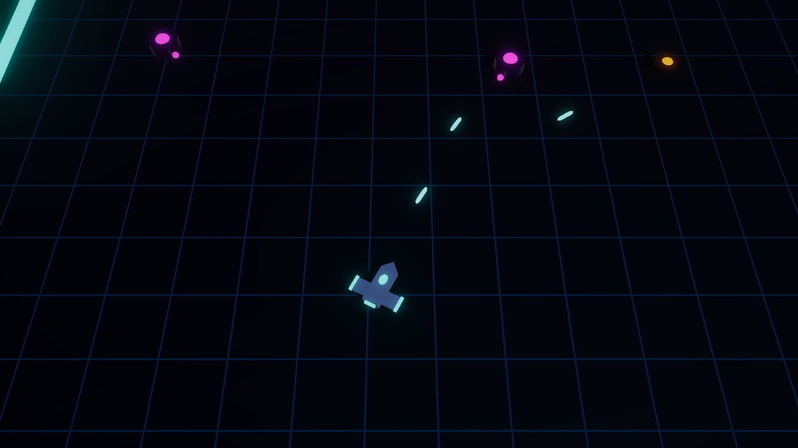

# Project Pathfinder: New Home

A top-down, twin-stick roguelite shooter in neon-lit 3D, built in Unity 6 (6000.0.67f1, URP).
The design lives in [docs/GDD.md](docs/GDD.md).



## Status

| Milestone | State |
|---|---|
| M0 Project setup | ✅ |
| M1 Core combat feel | ✅ playable sandbox, awaiting a playtest |
| M2–M6 | Planned (GDD §17) |

## Playing the combat sandbox

Open `Assets/_Project/Scenes/Run.unity` and press Play. Endless, escalating waves of Drones and Gunners spawn until the ship is destroyed.

| Action | Keyboard & Mouse | Gamepad |
|---|---|---|
| Move | WASD / arrows | Left stick |
| Aim | Mouse | Right stick |
| Fire | Left mouse | Right trigger |
| Dash (i-frames) | Space | A / Cross, RB |
| Reload | R | X / Square |
| Pause | Esc | Start |
| Restart after death | E | Y / Triangle |

Tuning lives in the ScriptableObjects under `Assets/_Project/Data` (ship, weapon, enemies) and on the brain
components in the enemy prefabs. To replay an exact run, set a seed code on **Combat World** in the Run scene.

## Project layout

```
Assets/_Project/
  Scripts/Core      Pure C# rules, no Unity dependency: RNG, vitals, weapons, dash (unit-tested)
  Scripts/Game      Unity runtime: simulation, player, enemies, presentation, run flow
  Scripts/Editor    Setup scripts and content builders
  Tests/EditMode    Unit tests (Core + Game helpers)
  Tests/PlayMode    Drives the real Run scene with scripted pilot commands
  Data, Prefabs, Art, Scenes, Settings, Input
```

## Editor tools

- **Pathfinder > Setup > Apply M0 Project Setup**: converts a fresh template into the 3D URP setup. Safe to rerun.
- **Pathfinder > Setup > Build M1 Content**: regenerates the placeholder art, prefabs and Run scene wiring.
  ScriptableObject data is never overwritten.

## Running tests from the command line

Close the Editor first, because batch mode can't open a project the Editor has open.

```bash
"D:/UnityInstalls/6000.0.67f1/Editor/Unity.exe" -batchmode -projectPath . -runTests -testPlatform EditMode -testResults editmode.xml
```

```bash
"D:/UnityInstalls/6000.0.67f1/Editor/Unity.exe" -batchmode -projectPath . -runTests -testPlatform PlayMode -testResults playmode.xml
```

Set `PATHFINDER_SCREENSHOT_DIR` before the PlayMode run to also save combat screenshots.
