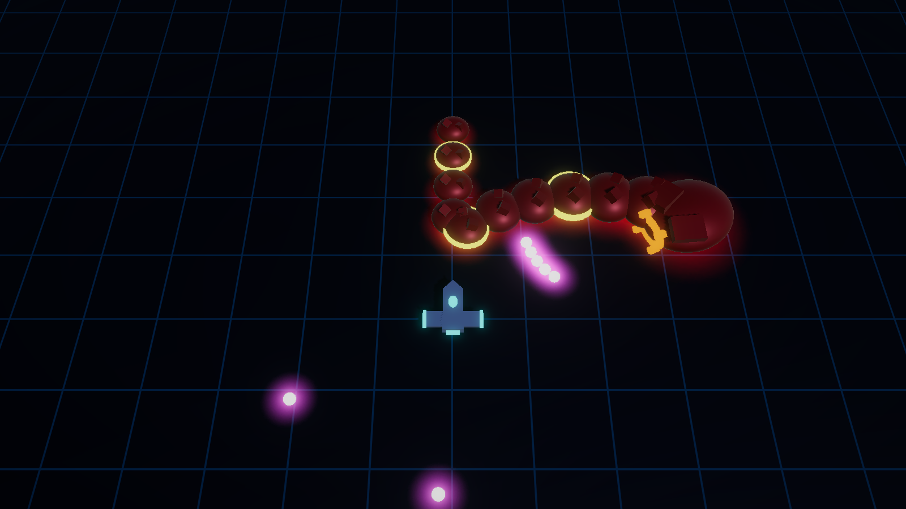
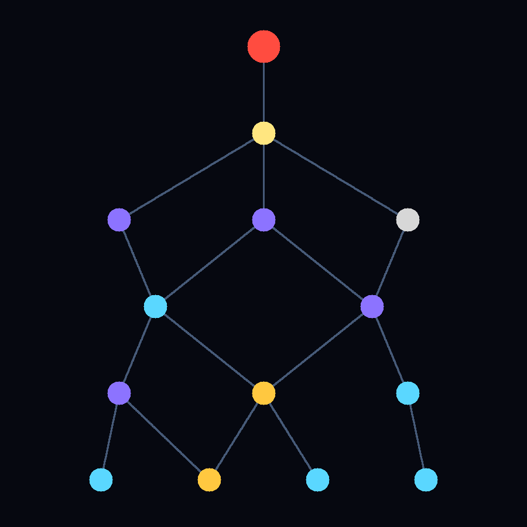

# Project Pathfinder: New Home

A top-down, twin-stick roguelite shooter in neon-lit 3D, built in Unity 6 (6000.0.67f1, URP).
The design lives in [docs/GDD.md](docs/GDD.md).


## Status

| Milestone | State |
|---|---|
| M0 Project setup | ✅ |
| M1 Core combat feel | ✅ playtested |
| M2 Combat breadth | ✅ 3 primaries, 2 secondaries, 5 enemy types + elites, wave director, Scraps |
| M3 Run structure | ✅ galaxy map, 7 level types, 3 galaxies, victory/defeat |
| M4 Build system | ✅ 20 equipment items, stats, choice cards, Shop catalog, Titan + Stormbringer traits, Hub loadout |
| M5 Boss + meta | ✅ the Quarry Maw (3-phase rock-worm boss), run summary with banked rewards, Pathfinder Lab upgrades, save file |
| M6 Slice polish | Planned (GDD §17): VFX, juice, audio, balance, external playtest |

## Playing

**A full run:** open `Assets/_Project/Scenes/Boot.unity` (or `Hub.unity`), press Play, choose **Start Run** and pick a ship and loadout. You can also
open `Run.unity` directly. Pick a route on the galaxy map, clear levels, fly into the wormhole, and beat three bosses to
reach New Home. The galaxy boss is **the Quarry Maw**: it burrows and erupts under you, sweeps its armoured body across
the arena, then enrages and spews bullet streams. Shoot the yellow weak points on its body for double damage.



When a run ends, the Dark Matter and Singularity Cores you earned are banked, plus 10% of the Scraps you collected.
Spend them in the Hub's **Pathfinder Lab**: Hull Plating, Shield Matrix, Salvage Protocols (starting Scraps), a Second
Dash Charge, and the Quantum Charger unlock. Progress is saved to `meta.json` in `Application.persistentDataPath`; delete
it to start a fresh profile.



**The combat sandbox:** open `Assets/_Project/Scenes/Sandbox.unity` and press Play. The wave director sends endless, escalating waves of Drones, Gunners, Spinners, Lancers and Carriers, with the occasional gold-ringed elite, until the ship is destroyed. Enemies drop gold Scraps that fly to the ship.

| Action | Keyboard & Mouse | Gamepad |
|---|---|---|
| Move | WASD / arrows | Left stick |
| Aim | Mouse | Right stick |
| Fire primary (hold to charge the Quantum Charger) | Left mouse | Right trigger |
| Fire secondary | Right mouse | Left trigger |
| Dash (i-frames) | Space | A / Cross, RB |
| Reload | R | X / Square |
| Pause | Esc | Start |
| Interact (stations), restart after a run | E | Y / Triangle |
| Galaxy map: choose a node | Left/Right + Enter, or click | D-pad / stick + A |

**Dev hotkeys** (Editor and development builds): **F1** cycle primary weapon, **F2** cycle secondary, **F3** god mode,
**F4** kill all enemies, **F5** skip to the next wave, **F6** skip the current level (Run scene), **F7** offer 3 random equipment.

Tuning lives in the ScriptableObjects under `Assets/_Project/Data`: ships, weapons, equipment (`Data/Equipment`), meta upgrades (`Data/Meta`), enemies, elites, and the wave config
`Waves/Waves_ShatteredExpanse`. Behaviour tuning (bursts, charge speed, launch rates, the Quarry Maw's phases) is on the brain components in the
enemy prefabs. To replay an exact run, set a seed code on **Combat World** in the Run scene.

## Project layout

```
Assets/_Project/
  Scripts/Core      Pure C# rules, no Unity dependency: RNG, vitals, weapons, dash (unit-tested)
  Scripts/Game      Unity runtime: simulation, player, enemies, presentation, run flow
  Scripts/Editor    Setup scripts and content builders
  Tests/EditMode    Unit tests (Core + Game helpers)
  Tests/PlayMode    Drives the real Run scene with scripted pilot commands
  Data, Prefabs, Art, Scenes, Settings, Input
```

## Editor tools

- **Pathfinder > Setup > Apply M0 Project Setup**: converts a fresh template into the 3D URP setup. Safe to rerun.
- **Pathfinder > Setup > Build Content**: regenerates the placeholder art and prefabs, and the wiring of the Sandbox, Run
  and Hub scenes. ScriptableObject data is never overwritten. New definitions are created when missing.
  Run tuning is in `Data/Run/RunConfig`.

## Running tests from the command line

Close the Editor first, because batch mode can't open a project the Editor has open.

```bash
"D:/UnityInstalls/6000.0.67f1/Editor/Unity.exe" -batchmode -projectPath . -runTests -testPlatform EditMode -testResults editmode.xml
```

```bash
"D:/UnityInstalls/6000.0.67f1/Editor/Unity.exe" -batchmode -projectPath . -runTests -testPlatform PlayMode -testResults playmode.xml
```

Set `PATHFINDER_SCREENSHOT_DIR` before the PlayMode run to also save combat screenshots.
