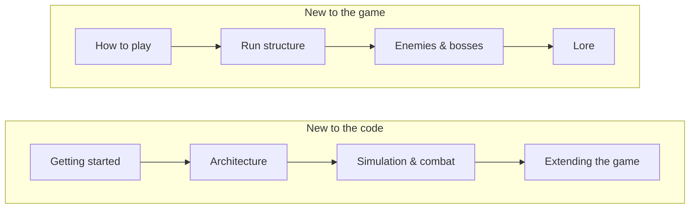

# Project Pathfinder: documentation

Everything about *Project Pathfinder: New Home* beyond the [project README](../README.md): how the code is put
together, how the game plays, and the world it is set in.

> [!TIP]
> These pages are plain Markdown, rendered by GitHub with its diagrams, callouts and tables. They live next to the
> code, so a change to a system and the page that explains it travel in the same commit. Browse them on GitHub, or
> open them in your IDE's Markdown preview.

## Where to start

| If you want to... | Read |
|---|---|
| Open the project, play it, run the tests, make a build | [Getting started](technical/getting-started.md) |
| Understand how the code is organised and why | [Architecture](technical/architecture.md) |
| Add an enemy, a boss, an item, a sound or a language | [Extending the game](technical/extending.md) |
| Look up what an enemy, item or currency does | [Game reference](game/README.md) |
| Know the world and its story | [Lore](lore/README.md) |
| See every design decision and number in one place | [Game Design Document](GDD.md) |

## Reading order

### Technical

| Page | What it covers |
|---|---|
| [Getting started](technical/getting-started.md) | Requirements, opening the project, the scenes, the content builder, dev hotkeys, command-line tests and builds, common problems |
| [Architecture](technical/architecture.md) | The core principles, assemblies and folders, how a scene is composed, determinism and seeds, co-op readiness |
| [Simulation & combat](technical/simulation.md) | The 60 Hz tick, entities, the damage pipeline, armour and weak points, projectiles, enemies and their brains, the wave director, the run flow |
| [Content pipeline](technical/content-pipeline.md) | Content definitions and IDs, the content builder, the content database, localization, the sound library |
| [Presentation](technical/presentation.md) | uGUI built from code, the HUD, telegraph visuals, camera, audio director, readability rules |
| [Extending the game](technical/extending.md) | Step-by-step recipes for new enemies, bosses, equipment, sounds, text, events and meta upgrades |
| [Testing](technical/testing.md) | EditMode and PlayMode tests, scripted pilots and bots, balance probes, screenshots |

### Game reference

| Page | What it covers |
|---|---|
| [How to play](game/how-to-play.md) | Controls, the HUD, a run from start to finish, options |
| [Run structure](game/run-structure.md) | Galaxies, the galaxy map, the seven level types, Mystery events |
| [Ships & weapons](game/ships-and-weapons.md) | Ships and traits, primary and secondary weapons, the dash |
| [Equipment](game/equipment.md) | Slots, rarity, levels, offers, and all 20 items |
| [Enemies](game/enemies.md) | All eight enemies, elites, spawning and scaling, how to beat each |
| [Bosses](game/bosses.md) | The Quarry Maw and the Binary Wardens |
| [Economy & meta](game/economy.md) | Scraps, Dark Matter, Singularity Cores, the Shop, the Pathfinder Lab |

### Lore

| Page | What it covers |
|---|---|
| [The world](lore/world.md) | A dying Earth, the Pathfinder, the Hub and the pilots |
| [The galaxies](lore/galaxies.md) | The Shattered Expanse, the Graveyard Drift, the Veil Nebula and New Home |
| [Factions & bestiary](lore/factions.md) | The Remnant, the Swarm, the machines and the guardians |

## Conventions

- **The GDD is the source of truth for design.** These pages explain and summarise; when they disagree, the
  [GDD](GDD.md) wins, and the page should be fixed.
- **Numbers are starting values for tuning.** The live values are in the ScriptableObjects under
  `Assets/_Project/Data` and on the enemy brain components in the prefabs.
- **Units:** distances are in Unity units (u). The arena is 60 × 40 u, and the ship is about 1 u across.
- **Keeping docs current:** when a change alters behaviour described here, update the page in the same commit.
