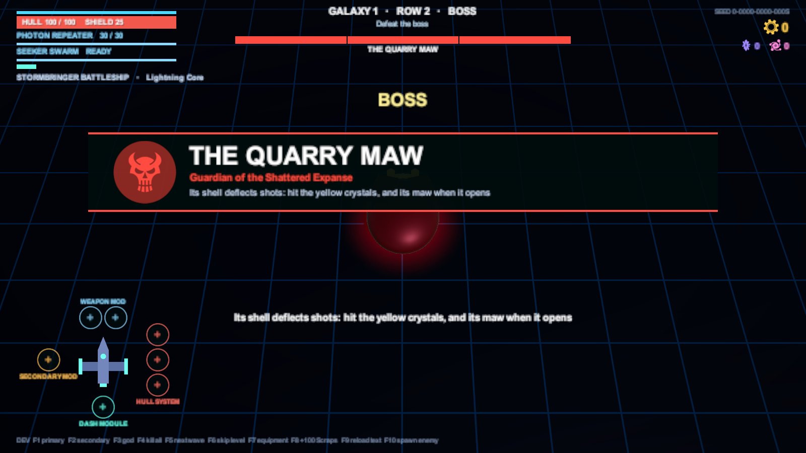
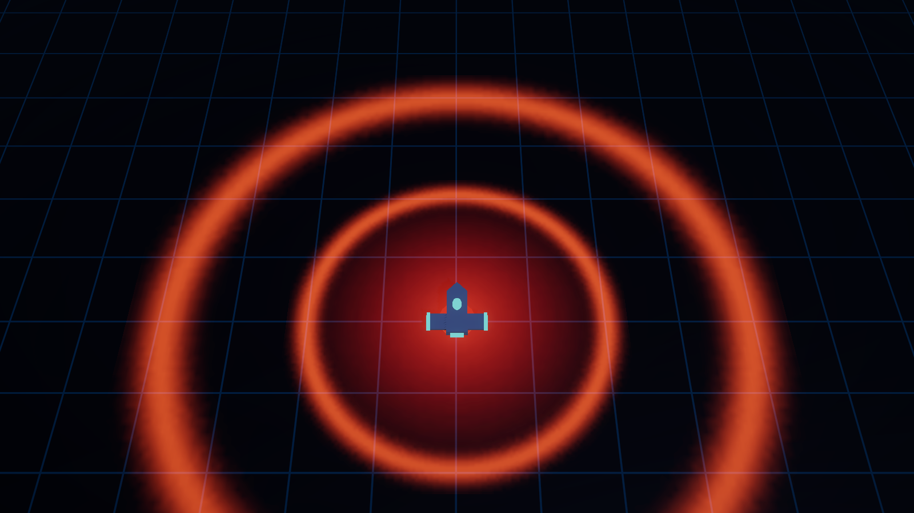
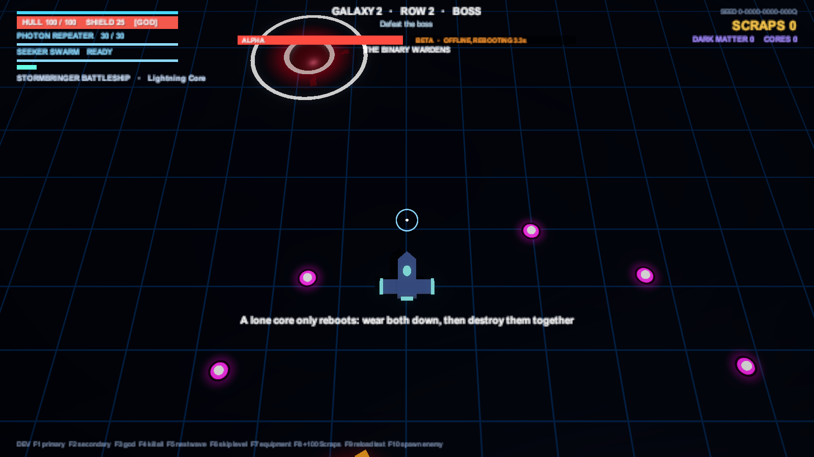
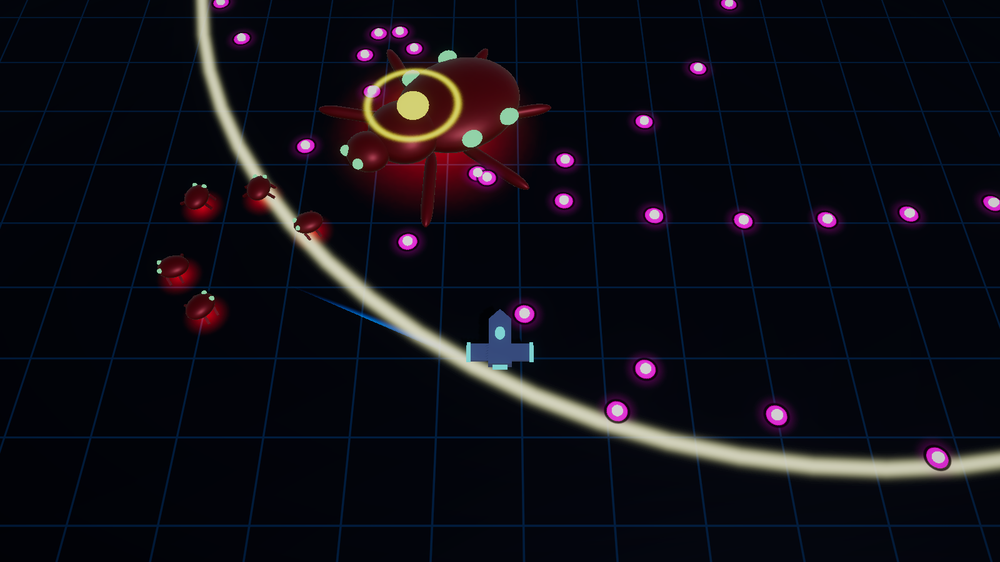
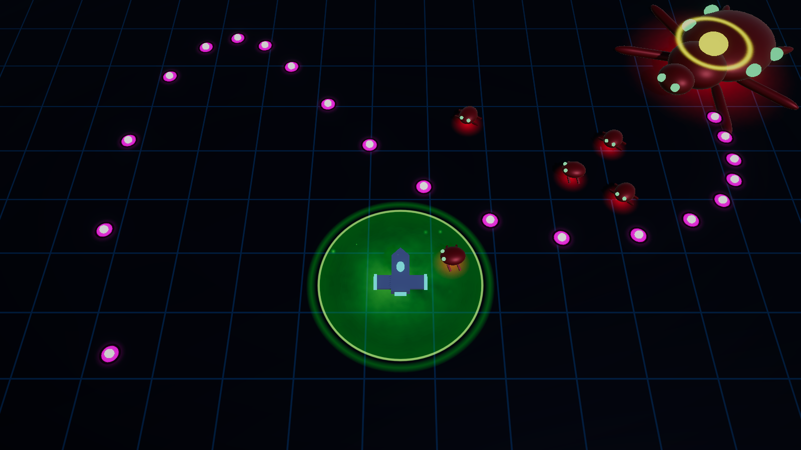
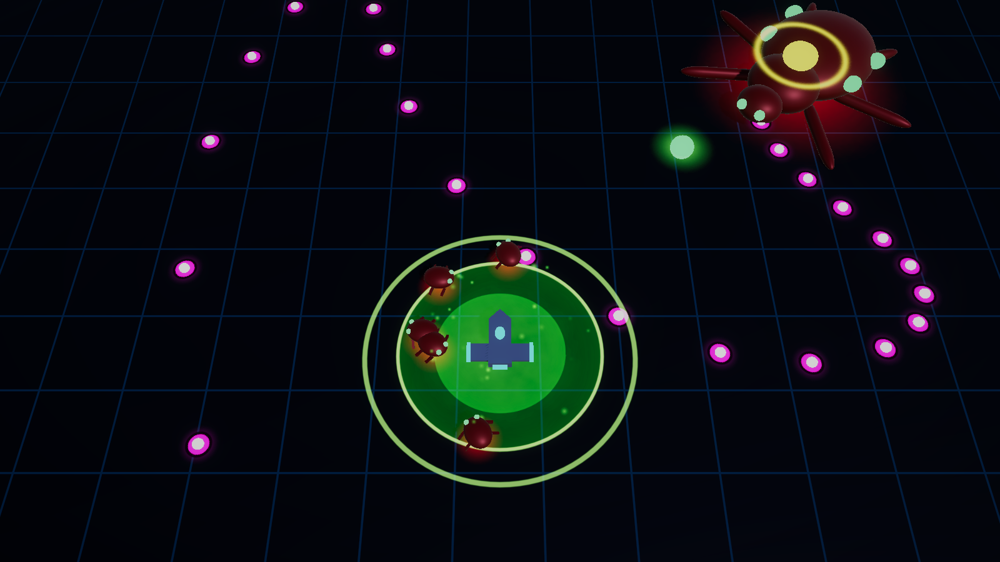

# Bosses

[Docs home](../README.md) › [Game reference](README.md) › Bosses

Each galaxy ends with a guardian. It makes an entrance: the fight holds while the camera turns to it and a card shows its
name, its title and how to hurt it (press confirm to skip). Beating it pays **Singularity Cores** (1 / 2 / 3 by
galaxy), **repairs your hull fully** and offers a **Rare-or-better item**. Then the wormhole pulls you into the next
galaxy.

([GDD §7.5](../GDD.md#75-bosses))

| Galaxy | Boss | The trick |
|---|---|---|
| 1 | [The Quarry Maw](#the-quarry-maw) | Its shell deflects everything: hit the yellow crystals, and its maw when it opens |
| 2 | [The Binary Wardens](#the-binary-wardens) | Two cores; one alone only reboots. Wear both down and finish them together |
| 3 | [The Hive Matriarch](#the-hive-matriarch) | Shoot the yellow heart on her back, get out of the green spore circles, dash through her bloom rings |

Every boss fight opens with a one-line hint on how to hurt it. When a boss dies, **every enemy bullet in the air turns
harmless** and fades out, so a stray shot can't kill you after you've won.

---

## The Quarry Maw

A colossal rock-worm: a head and **12 segments** trailing behind, all sharing one pool of **5,500 HP** (×1.6 and ×2.4
in later galaxies). Nothing knocks it back.

**Its shell is armour.** Shots on the head or a plain segment stop with a grey spark. Every third segment carries a
**yellow weak point**, and its **maw opens** (a big yellow crystal on the head) while it dives, emerges and rests
between charges, and all through the enrage. Seeker missiles, Ricochet and Lightning Core skip the armour and find the
weak points. Each phase change opens with a **1.5 s roar**, during which even the weak points are shut.

### Phase 1: Burrow (above 2/3 health)

- It **slithers around you side-on** at about 8 u, so its weak points face your guns, spitting a 3-bullet burst every
  1.6 s.
- After 5 s it **rears up, opens its maw and sinks** into the ground over 1.4 s: shoot it all the way down.
- Underground it can't be hit. A **red circle follows you**: it fills in from the middle while a **ring closes in**
  on its outline, and when they meet, it erupts. 0.4 s before, the spot locks and the circle flashes: **dash** out,
  because walking won't make it. It **erupts** there: 30 damage within 3 u and **two rings of rocks**, a fast one and a
  slower one offset between them.
  It rises with its maw open.

> Walking won't get you clear once it locks: **dash** as the ring closes. Then weave through the gap between the two
> rings.

### Phase 2: Sweep (2/3 to 1/3)

- Volleys of **two charges**, each from wherever its head is, **through your position**, to the far side of the arena,
  shown first by a large chevron lane.
- Charging, it sheds **rocks to both sides** every 0.18 s, leaving expanding walls to slip through or dash across.
- After a volley it **rests for 4.5 s, maw open**, coiling slowly around you: the big window to hurt it.

### Phase 3: Enrage (below 1/3)

- The maw stays open. It circles you at 9 u, **much faster than before** (7.2 u/s, nearly your own speed), firing a
  **5-bullet stream** every 0.6 s, with a **16-rock shower** every 5 s.
- Every 8 s it stops, flares, and spins a **3-arm spiral** of bullets for 2.4 s.

---

## The Binary Wardens

The twin defence cores of a dead station: one AI that **splits in two**, **Alpha** (a ring of six spinning emitters)
and **Beta** (a cross of blades). Each core has **2,200 HP** (3,520 in galaxy 2) and its own health bar.

### The fight

- **Split.** The boss arrives as one core and splits; the two fly apart to opposite sides of the arena centre. They
  can't be hurt while they separate (2 s).
- **Orbit.** The cores circle the centre on opposite sides, the orbit slowly growing and shrinking (5.5 to 8.5 u).
- **The tether.** A crackling orange line joins them. It always passes **through the arena centre** and sweeps round
  like a clock hand: **15 damage** if it crosses you. Whenever it reconnects it flickers thin and harmless for 1.2 s
  first.
- **Attacks.** Each core flares before a volley. Alpha fires **rings of 14 bullets** every 2.6 s, each ring turned a
  little from the last. Beta fires **5-bullet fans** at you every 2 s.

### Offline, reboot and the kill

- Bring one core to zero **while its twin is up**, and it only goes **offline**: it sinks into the floor, goes dark,
  shrugs off shots (grey sparks) and can't hurt you by touch. A **grey ring fills** around it, and its health bar
  counts down: in **5 s it reboots at half health**.
- While one core is down, the tether is gone, but **the other enrages** and attacks 1.5× faster.
- Destroy the second core **while the first is still offline**, and **both fall together**.

> [!TIP]
> Don't burn one core down alone. Keep them roughly level by switching targets, so when one goes offline the other is
> already low enough to finish within 5 s. The HUD shows both bars side by side for exactly this.

---

## The Hive Matriarch

The Swarm's queen, half-fused with the Veil Nebula, and the last thing between you and New Home. **4,800 HP** (11,520
at galaxy 3 strength). Her carapace deflects shots; her **yellow heart** is open, and she takes damage, **except while
she roars, charges or gathers a pulse**. Her creatures and hazards glow toxic green.

### Phase 1: Brood (above 2/3 health)

- She drifts along the top of the arena, sweeping a **flowing bullet stream** at you.
- Every few seconds she births a brood of **Broodlings**: small, weaving critters that bite on contact.
- She lobs **spore pods** where you are. You see the pod fly; where it will land, a green circle fills in from the
  middle while a ring closes in, like the Quarry Maw's eruption, and it flashes just before impact. If you're still
  inside when it lands, the pod **bursts** on you. It leaves a **spore cloud** for 6 s that **burns** and
  **slows** you while you're inside.

> Keep moving so the pods land behind you, and clear the brood before it surrounds you.

### Phase 2: Frenzy (2/3 to 1/3)

- **Two charges** through you, each shown by a chevron lane, each ending in a **double ring** of bullets: two waves at
  different speeds.
- Her heart stays **open while she lines up each charge**, and shuts only while she's actually charging.
- After the volley she **rests 5 s, barely moving, heart open**: the best window to hurt her.

### Phase 3: Bloom (below 1/3)

- She returns to the centre and spins a **wobbling spiral**.
- Every few seconds she gathers herself (heart shut) and releases a **bloom pulse**: a solid green ring with **no gap**
  that sweeps the whole arena.

> You can't outrun a bloom ring. **Dash through it** as it reaches you.

When she dies, her brood dies with her, and the run is won.
