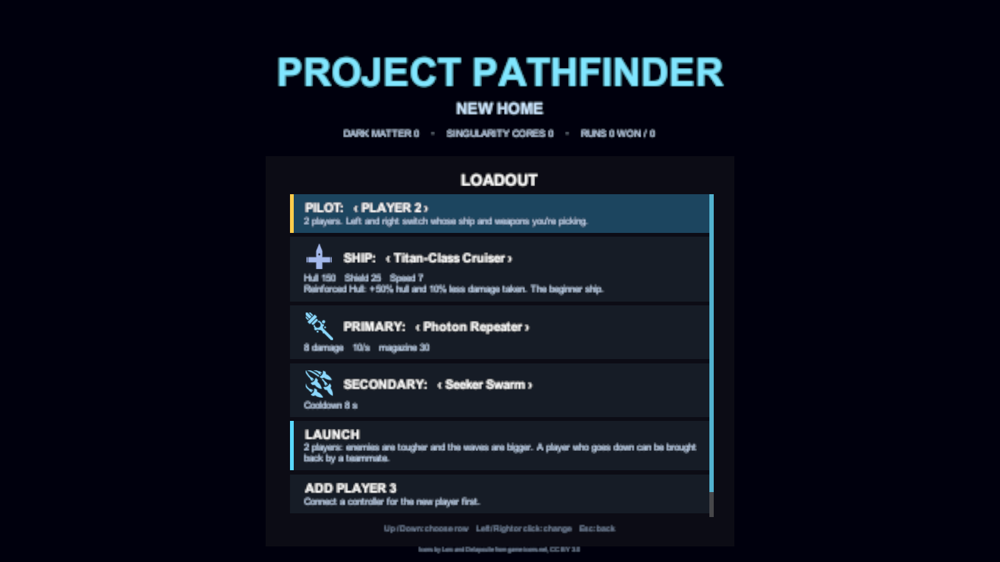
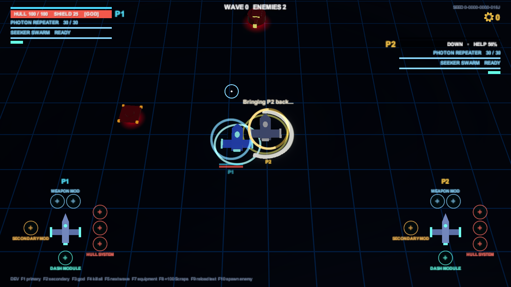

# Local co-op

[Docs home](../README.md) › [Game reference](README.md) › Local co-op

Up to four players on one screen, each with their own controller *(M8)*. Runs and Survival both work in co-op.

## Joining

Player 1 is always in, playing with the keyboard and mouse or a gamepad. Everyone else joins with a gamepad of their
own (PlayStation and Xbox controllers both work):

1. In the Hub, choose **Start Run** or **Survival** to open the loadout page.
2. Choose **ADD PLAYER 2**. The row turns gold and waits.
3. The new player presses any button on their controller. The controller player 1 used to choose the row can't join
   again, so player 1 can be on a gamepad too.

Esc or Circle/B stops waiting.

Each player picks their own ship and weapons: the **PILOT** row at the top switches whose loadout the rows below
show. **REMOVE PLAYER 2** lets a player leave. Players stay joined, with their picks remembered, until the game is
closed.

## On screen

- **One shared screen.** The camera keeps every ship in view, pulling back as you spread out, as far as the whole
  arena. It never splits.
- **Colours.** Each player has a colour, with a ring under their ship and a tag on their readout and panel: P1
  cyan, P2 gold, P3 violet, P4 pink.
- **Panels.** P1's panel is top left, P2's top right, P3's and P4's below them. P1's ship and slots are bottom left
  and P2's bottom right.
- **Crosshairs.** Each player has their own. Only player 1 can aim with the mouse.

## Going down, and coming back

When a ship's hull runs out in co-op, it doesn't explode away. It stays where it fell as a dark **wreck**, calling for
help.

- **Revive:** a teammate hovers close to the wreck (within 2.5 u) for **2 seconds**. A ring fills around it as they
  do. The pilot comes back with **15% hull** and 2 seconds in which nothing can hit them.
- **Moving away** lets the ring slowly drain, at half the speed it fills.
- **Between levels:** a pilot who is still down comes back at the start of the next level, with the same 15%. When a
  boss or a Survival guardian falls, everyone is brought back and patched up.
- **The run is lost only when every pilot is down at once.**

## Sharing

- **Scraps are shared.** There's one wallet: anyone's pickups go in, and anyone can spend them in the Shop. Level
  bonuses are paid once, into the shared wallet.
- **Equipment is your own.** Equipment caches, boss rewards and Mystery event finds give **every player a pick in
  turn**, starting with whoever opened it. Each pick names the player and answers only to their controller.
- **The Shop and the repair station** open for whoever flies up and presses Interact, and only their controller works
  the menu. A repair station serves each player once.
- **Player 1 picks the next node** on the galaxy map. **Any player can pause**, and a pause stops everyone.

## Harder for more

Enemies get more health for each extra player, and waves get a bigger budget, so there are more enemies:

| Players | Enemy health | Wave budget |
|---|---|---|
| 1 | ×1 | ×1 |
| 2 | ×1.65 | ×1.5 |
| 3 | ×2.3 | ×2 |
| 4 | ×2.95 | ×2.5 |

Bosses and guardians get the extra health too. Arena hazards (asteroids, laser pylons) don't.

## Saving

A co-op run saves every pilot: ship, weapons, equipment and hull. **Continue Run** in the Hub says how many flew it. A
player who hasn't joined this time misses out, and a new player starts fresh.
