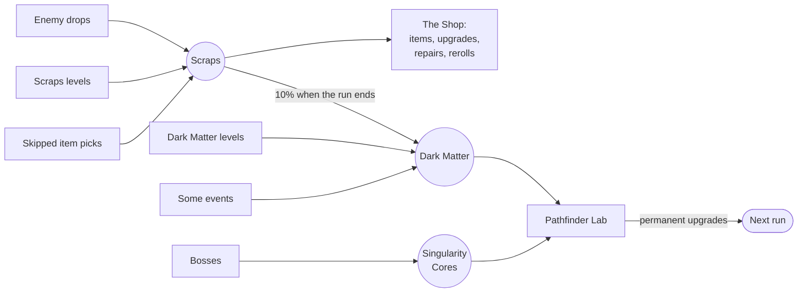
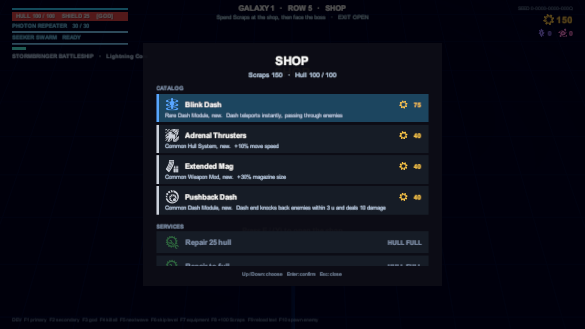

# Economy & meta progression

[Docs home](../README.md) › [Game reference](README.md) › Economy & meta

Three currencies: one for the current run, two that you keep forever. ([GDD §11](../GDD.md#11-economy--meta-progression))

| Currency | Kept | Earned from | Spent on |
|---|---|---|---|
| **Scraps** (gold) | This run only | Enemy drops, Scraps levels, skipping an item pick (15), events | The Shop |
| **Dark Matter** (indigo) | Forever | Dark Matter levels (the main source), some events, and **10% of the Scraps you collected**, banked when the run ends | Lab upgrades, weapon unlocks |
| **Singularity Cores** | Forever | Bosses only: 1 / 2 / 3 by galaxy | Major Lab upgrades, ship unlocks |

## The Shop

Always the node right before the boss. No enemies.

| Service | Price |
|---|---|
| Buy an item (a catalog of 4) | Common 40 · Rare 75 · Epic 120 Scraps |
| Upgrade an equipped item | I→II 35 · II→III 60 Scraps |
| Repair hull | 1 Scrap per point |
| Reroll the catalog | 15 Scraps, +10 for each reroll after that |

Buying into a full category opens the swap screen; you only pay if you confirm the swap.

## Banking

When a run ends, win or lose, it banks:

- every **Dark Matter** and **Singularity Core** earned in the run, and
- **10% of all Scraps collected** in the run, rounded down, as Dark Matter. Spent Scraps count; the starting Scraps
  from Salvage Protocols don't, so the upgrade can't pay for itself.

The run summary shows what was banked. The profile also counts runs played, runs won and the best galaxy reached.

[Survival](survival.md) banks the same way when it ends (Dark Matter for each minute on the clock, the guardians'
Cores, 10% of Scraps) and keeps your best time, but doesn't count as a run.

## The Pathfinder Lab

Permanent upgrades, bought in the Hub.

| Upgrade | Currency | Tiers and costs | Effect |
|---|---|---|---|
| **Hull Plating** | Dark Matter | 30 / 60 / 90 / 120 / 150 | +10 max hull per tier |
| **Shield Matrix** | Dark Matter | 50 / 100 / 150 | +10 max shield per tier |
| **Salvage Protocols** | Dark Matter | 40 / 80 / 120 | Start each run with +25 Scraps per tier |
| **Second Dash Charge** | Singularity Cores | 2 | +1 dash charge |
| **Quantum Charger** | Dark Matter | 150 | Unlocks the weapon for your loadout |

Planned: Reroll Credits, Field Repairs, ship unlocks (2 / 3 / 4 Cores), a second dash module slot, Epic Research, and
later **Pathfinder Protocols**, optional difficulty modifiers for bonus rewards.

## How it adds up

From the balance probe (a perfect-aim bot in galaxy 1, row 3):

| Level | Scraps | Dark Matter |
|---|---|---|
| Scraps level | about 90 (including the 30 bonus) | |
| Equipment level | 35 (including 15 for skipping the cache) | |
| Dark Matter level | about 10 | 50 (all 12 crystals) |

- A typical path reaches the Shop with **120–150 Scraps**: a Rare plus a Common, or one Epic, or an upgrade and a
  repair. A real decision, not a shopping spree.
- A run that reaches galaxy 2 banks about **120–150 Dark Matter**. The slice's Lab costs about 1,140 in total, so
  roughly **8 runs** of progression.

## Where it's saved

The profile is `meta.json` in the game's data folder (on Windows,
`%USERPROFILE%\AppData\LocalLow\DefaultCompany\pathfinder\`), written after every banking and purchase. A corrupt file
is set aside as `meta.json.corrupt` and a fresh profile starts, so a bad file never blocks play. Delete `meta.json` to
start over.
