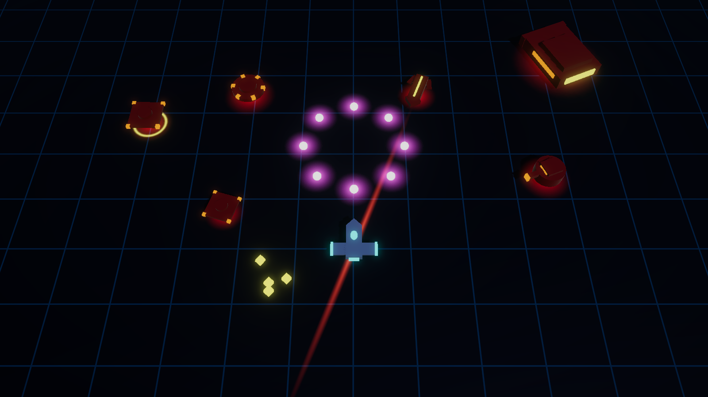
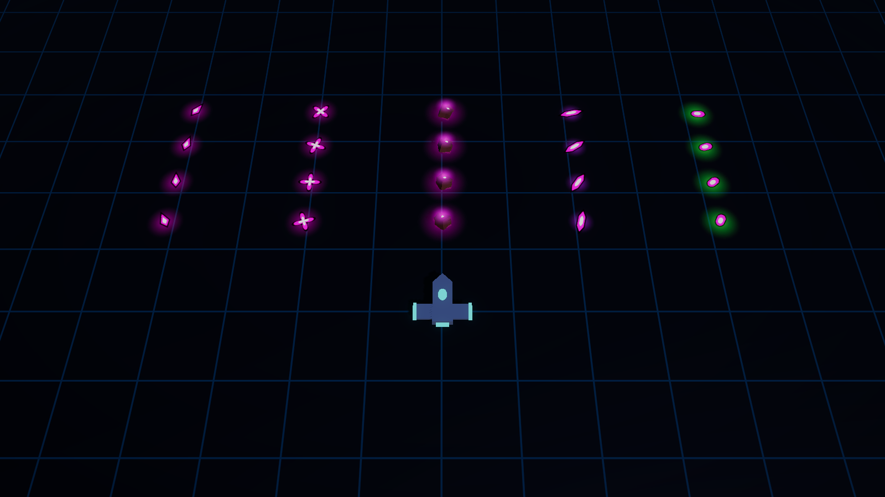
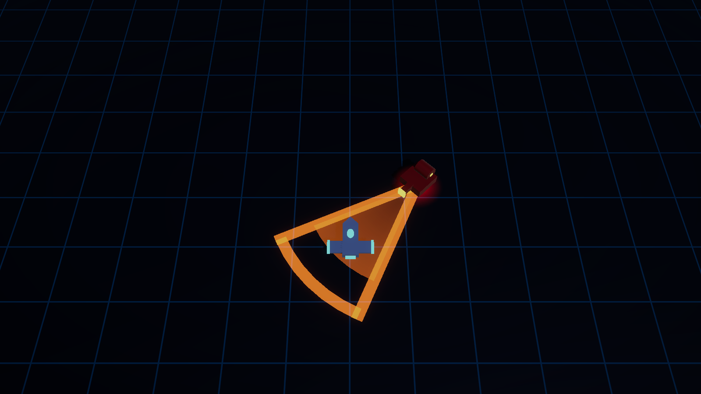
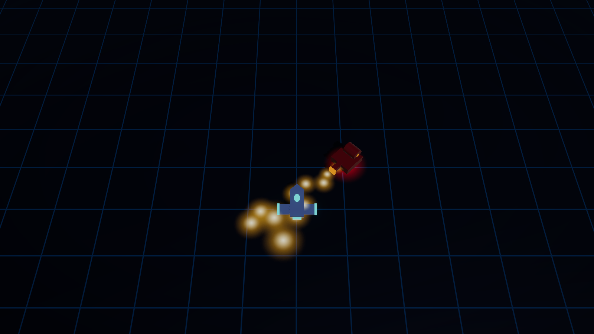
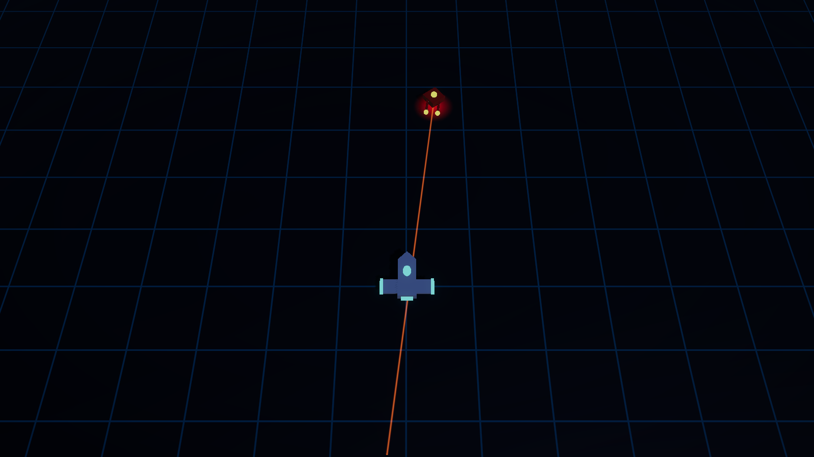
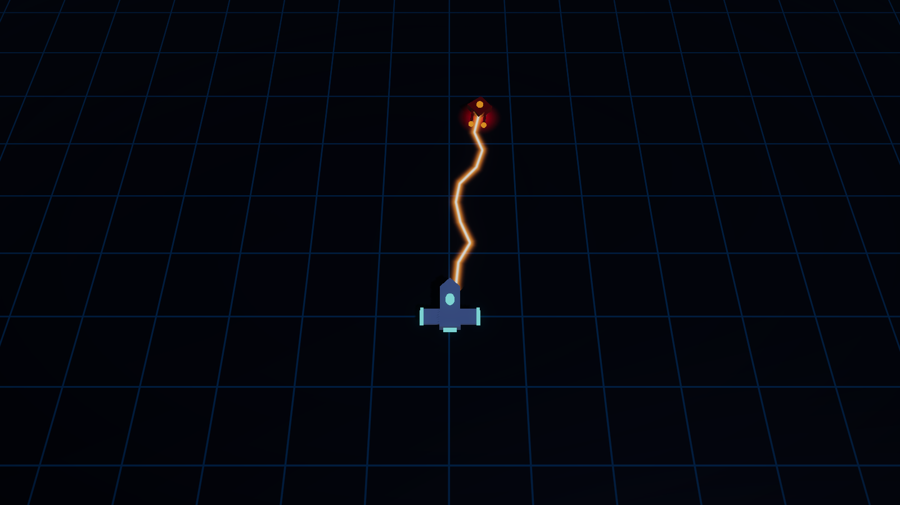
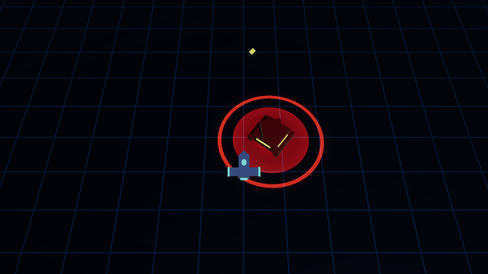
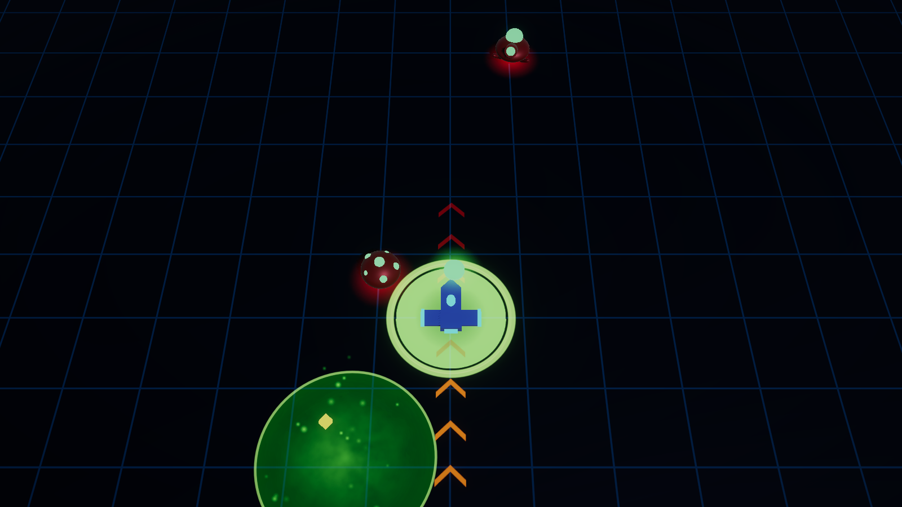
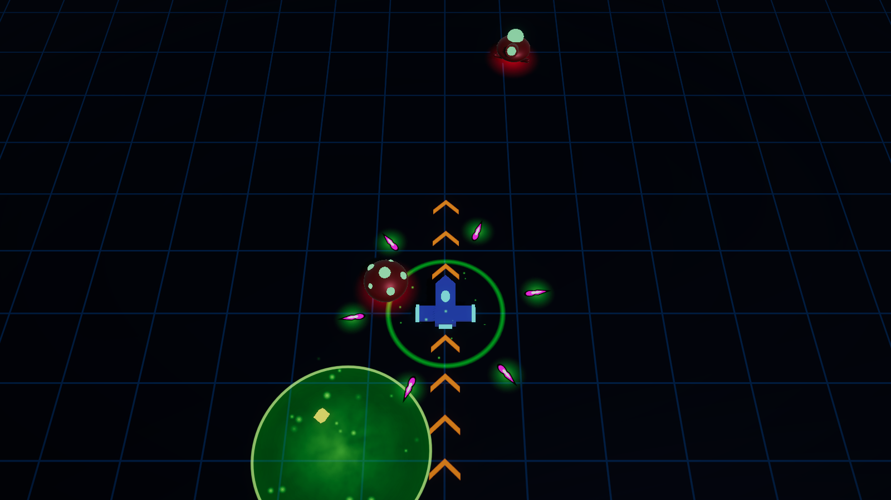

# Enemies

[Docs home](../README.md) › [Game reference](README.md) › Enemies

Every enemy is a crimson machine with red-orange accent lights over a red floor glow. **Before any attack its accents
flare and it plays its own wind-up sound**, so you can read a crowded arena by ear as well as by eye.
([GDD §7.3](../GDD.md#73-enemy-archetypes))

Every enemy shot has a magenta body and a dark outline, so it reads as danger at a glance, but **each shooter fires its
own shape** *(playtest 7)*: left to right, the Gunner's darts, the Spinner's spinning stars, the Quarry Maw's glowing
rocks, the Binary Wardens' crystal shards and the Hive Matriarch's green-glowing seeds.

## At a glance

| Enemy | From | HP | Speed | Cost | Threat | Beat it by |
|---|---|---|---|---|---|---|
| [Drone](#drone) | Galaxy 1 | 15 | 5.5 | 1 | Swarms you, contact damage | Keep moving; a few shots each |
| [Gunner](#gunner) | Galaxy 1 | 35 | 4 | 2 | Aimed 3-shot bursts from range | Strafe sideways after its glow |
| [Spinner](#spinner) | Galaxy 1, wave 2 | 60 | 2 | 3 | Rotating bullet rings | Slip through the moving gaps |
| [Lancer](#lancer) | Galaxy 1, wave 2 | 60 | 4.5 | 3 | Telegraphed high-speed charges | Step off the chevron lane; punish the wind-down |
| [Carrier](#carrier) | Galaxy 1, wave 4 | 150 | 1.8 | 6 | Launches Drones; armoured front | Flank it and shoot the yellow rear |
| [Scorcher](#scorcher) | Galaxy 2 | 45 | 3.2 | 3 | Flamethrower cone up close | Stay out of the cone; hit it during the cooldown |
| [Arc Drone](#arc-drone) | Galaxy 2 | 20 | 5 | 2 | Instant zap along a locked line | Step off the line, or dash through |
| [Crusher](#crusher) | Galaxy 2, wave 2 | 110 | 2.8 | 4 | A lunging slam if it reaches you | Move away the moment its ring appears; shoot it while it recovers |
| [Spore Drifter](#spore-drifter) | Galaxy 3 | 35 | 2.2 | 2 | Bursts into a spore cloud when killed | Pop it at range; step out of the cloud |
| [Stinger](#stinger) | Galaxy 3 | 22 | 6.5 | 2 | Circles you, then darts through you | Step off the chevron lane; it's fragile |
| [Spitter](#spitter) | Galaxy 3, wave 2 | 40 | 2.4 | 3 | Lobbed globs that burst into thorns | Leave the landing mark; close in on it |

Speeds are in units per second (the ship flies at 8). Cost is the wave director's budget price.

## Galaxy 1: the Shattered Expanse

### Drone

A spinning blade that chases the ship, weaving as it closes in. It deals **10 contact damage**, then bounces off and
can't hit again for 0.75 s. Alone it's nothing; in a swarm it boxes you in.

### Gunner

Keeps **8–12 u** away and strafes. Every 2 s it **glows for 0.45 s** (a two-tone lock-on beep), then fires a
**3-shot burst** of 8-damage bullets at where you are. It slows to 30% while attacking.

> Move *sideways* when it glows: the burst is aimed at your position when it fires.

### Spinner

A slow disc ringed with emitters that holds 6–13 u away. Every 1.8 s the emitters **flare for 0.35 s** (a warble),
then it fires a **ring of 10 bullets** (8 damage, 6 u/s). Each ring is turned 11° from the last, so the gaps move.

### Lancer

An arrowhead that closes in. Within 9 u it plants itself and shows a **lane of chevrons** along its charge for 0.7 s
(a rising whine), the chevrons lighting up from the Lancer outward. Then it charges **14 u at 24 u/s** for **30
damage**. Every charge ends in a **0.6 s skid**; after a miss it re-aims and **jousts once more**. After its last charge
it recovers for 1 s and waits 1.8 s.

> The chevrons are a path, not a bullet: step off the lane. The skid and the recovery are when it's open.

### Carrier

A slow tank that keeps about 10 u away and turns at only 60°/s. Every 4 s its flank bays flare (a low horn) and it
launches **2 Drones**, with at most 6 alive; launched Drones drop no Scraps. They outlive their Carrier, and a level's
waves aren't cleared until they're dead too. Its **armoured front takes 60% damage**;
its **yellow rear weak point takes 200%**.

## Galaxy 2: the Graveyard Drift

These join the mix from galaxy 2. In the combat sandbox they appear from wave 6, and **F10** spawns any enemy.

### Scorcher

 

A squat flamethrower tank. Within **4.5 u** it plants itself for **0.6 s** while an **orange cone** (±18°, 5.6 u)
fills in on the floor (an ignition hiss). Then it **sprays for 1.4 s**: a stream of flames (4 damage each) that billow
as they fly and wash over the ship, while it turns after you at 60°/s and creeps forward. Standing in the fire costs
about **13 hull per second**. Then it cools down for 2.2 s at half speed.

> Its reach is short. Back off or circle out of the cone during the wind-up, then punish the cooldown.

### Arc Drone

 

A fragile hovering drone with two coil prongs that strafes at **6–8.5 u**. It **locks onto where you are** and
charges for **0.7 s**, showing a thin, flickering red line through that spot out to its 12 u reach (a rising electric
buzz). Then it fires **instantly** along the locked line: **14 damage** to the first ship it touches.

> The line doesn't follow you: one sidestep during the charge and it misses. Dashing through the bolt works too. Only
> 20 HP, so kill it first when you can.

### Crusher

A heavy armoured block on treads, slow and almost **immune to knockback** (15%). When it gets within **3.2 u** it rears
up for **0.4 s** behind a **red ring** at its 3.3 u reach (a servo groan), with a fill growing out to the ring, and
**lunges at you**. Then it **slams: 40 damage** to everything in the ring, with a shockwave. It recovers, motionless,
for 1 s.

> Don't let it get close. Move away the instant the ring appears, or dash out of it: drifting away isn't enough, it
> lunges. Its recovery is the time to unload on it.

## The Swarm

### Broodling

Born by the [Hive Matriarch](bosses.md#the-hive-matriarch) in broods of five: small crimson grubs with glowing green
eyes. 12 HP, 6.5 u/s, 8 contact damage. They chase in a weaving line and dart forward now and then, so a brood flows
around you rather than marching at you. They drop nothing, and die with their queen.

From galaxy 3, the Veil Nebula, three Swarm creatures join the waves *(M7)*. Crimson bodies with the Swarm's green glow,
like the brood.

### Spore Drifter

A swollen spore sac, breathing slowly, studded with glowing green pustules. 35 HP, 2.2 u/s, 10 contact damage. It floats
after you on a lazy sideways sway, and when it dies it **bursts into a spore cloud** (2.2 u, 5 s): inside, you're slowed
to 60% and burn for 4 every 0.5 s.

> Pop it before it reaches you. Shot down up close, it leaves its cloud on top of you.

### Stinger

A slim insect on buzzing wings, with a green sting out front. 22 HP, 6.5 u/s, 9 contact damage. It **circles you** at
about 6 u, then stops short for 0.6 s behind a **chevron lane** through you and past you, and **darts** along it at
22 u/s, stinging harder than a touch. Then it rests for a moment.

> It comes from the side, not head-on. Watch for the lane and step off it; one or two hits bring it down.

### Spitter

 

A squat pod on short legs, with its mouth tipped up and a green sac on its back. 40 HP, 2.4 u/s, 8 contact damage. It
keeps about 10 u away and, every few seconds, its sac swells and it **lobs a seed glob** at where you are. A landing
mark fills in while a ring closes in on it; the glob hits for 12 if you're still under it, and **bursts into a ring of
6 thorns** flying outward.

> Leave the mark the moment it appears, and keep clear of its edge as the thorns fly out. Then close in: it's slow,
> and a glob still in the air when it dies falls harmlessly.

## Arena hazards

Each galaxy's combat levels carry a hazard *(M7)*: they hurt, but they aren't enemies, and a level never waits for them.
See [Run structure](run-structure.md#the-galaxies).

| Hazard | Galaxy | Health | What it does |
|---|---|---|---|
| **Asteroid** | The Shattered Expanse | 30 | Drifts across the arena, bouncing off the walls; 12 damage on contact. Blocks shots. Breaks for a scrap (60%), and another drifts in 5 s later |
| **Laser Pylon** | The Graveyard Drift | 120 | Sweeps a two-armed orange beam (7 u each way, 12 damage); powers down briefly every 6 s and flickers before powering up. Shoot it to switch it off (4 Scraps) |
| Spore cloud | The Veil Nebula | n/a | Drifts slowly; inside, you're slowed to 60% and burn for 4 every 0.6 s |

## Elites

Any enemy can roll as an **elite**: bigger (×1.2), with a **gold ring** under it, and it **always drops ×3 Scraps**.
An elite costs double budget.

| Modifier | Effect |
|---|---|
| **Armored** | ×2 health, ×0.75 speed |
| **Hasty** | ×1.5 speed, and attacks ×1.5 faster (cooldowns, wind-ups and bursts) |

The chance rises per wave, map row and galaxy: `min(35%, 3% + 2% per wave + 4% per row + 5% per galaxy)`. Splitting
and Volatile elites are planned.

## Spawning and scaling

- Each wave has a **budget**: `6 × galaxy (1.0 / 1.4 / 1.8) × (1 + 15% per row) × (1 + 25% per wave)`. The director
  buys a random weighted mix of affordable enemies with it, up to 40 per wave.
- Spawns are announced by a **red glow on the floor for 1 s** and never land within 6 u of a ship.
- The next wave comes when 80% of the current one is dead, or after 25 s.
- **Enemy health scales by galaxy:** ×1.0, ×1.6, ×2.4.

## Drops

| Enemy | Scraps | Chance |
|---|---|---|
| Drone | 1 | 50% |
| Gunner | 2 | 75% |
| Spinner | 3 | 85% |
| Lancer | 2 | 80% |
| Carrier | 8 | 100% |
| Scorcher | 2 | 80% |
| Arc Drone | 1 | 70% |
| Crusher | 4 | 90% |
| Spore Drifter | 1 | 70% |
| Stinger | 1 | 70% |
| Spitter | 2 | 80% |
| Elites | ×3 | always |

Scraps settle on the floor, fly to the ship inside its magnet radius and blink out after 10 s. When a fight is won,
every Scrap left on the floor flies to you.
