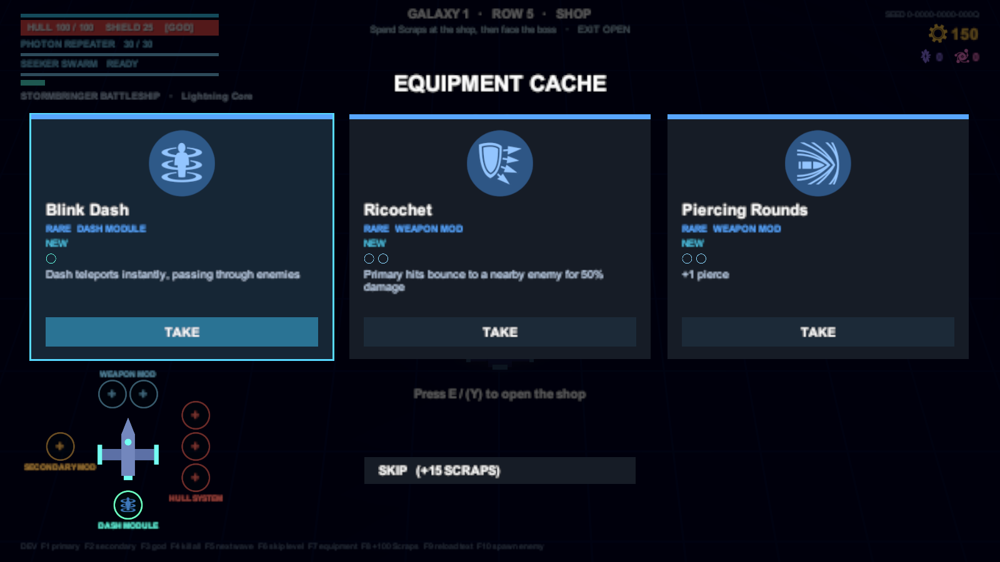

# Equipment

[Docs home](../README.md) › [Game reference](README.md) › Equipment

Equipment is the heart of a build. You find it in Equipment levels, Mystery events, after bosses and in the Shop, and
you lose it when the run ends. ([GDD §8](../GDD.md#8-equipment-in-run-build-system))

## How it works

| Category | Slots | Affects |
|---|---|---|
| **Dash module** | 1 | How the dash behaves |
| **Weapon mod** | 2 | The primary weapon |
| **Secondary mod** | 1 | The secondary weapon |
| **Hull system** | 3 | Passive stats and effects |

- **Rarity:** Common, Rare or Epic. Rarity sets how strong an item is and how often it is offered.
- **Levels I → II → III.** Upgrade in the Shop (35 Scraps for I→II, 60 for II→III). Picking an item you already have
  raises its level for free.
- **Full category:** taking a new item means **swapping** one out (the old one is lost), or skipping.
- **Seeing your slots** *(playtest 7)*: the ship at the bottom left of the HUD shows every slot, filled or free, each
  group in its own colour. Pointing at an item in the Shop or on a card lights up where it would go (gold for a swap),
  and each card shows its category's slots as dots, solid for the ones in use.
- **Stats stack** as `(base + all flat bonuses) × (1 + all percent bonuses)`. Percentages from different items add up.

### Offers

An equipment choice shows **3 items**. Each slot rolls a rarity from the galaxy's odds, then an item of that rarity.
An offer never repeats an item, and items already at level III aren't offered. Caches from Mystery levels and boss
rewards are **Rare or better**.

| Galaxy | Common | Rare | Epic |
|---|---|---|---|
| 1 | 70% | 25% | 5% |
| 2 | 55% | 33% | 12% |
| 3 | 40% | 40% | 20% |

## All items

Values are for levels I / II / III.

### Dash modules

| Item | Rarity | Effect |
|---|---|---|
| **Phase Dash** | Rare | Dash i-frames last 0.2 / 0.3 / 0.4 s longer. Each enemy bullet you phase through restores 2 shield. |
| **Blink Dash** | Rare | The dash teleports instantly, through enemies, +0 / 1 / 2 u further. |
| **Pushback Dash** | Common | The dash end knocks back enemies within 3 / 3.5 / 4 u and deals 10 / 20 / 30 damage. |
| **Bullet Dash** | Epic | The dash end fires a ring of 8 / 12 / 16 primary projectiles, with your weapon's properties. |

### Weapon mods

| Item | Rarity | Effect |
|---|---|---|
| **Overclock** | Rare | +15 / 30 / 45% fire rate |
| **Extended Mag** | Common | +30 / 60 / 90% magazine size |
| **Piercing Rounds** | Rare | Projectiles pierce +1 / 2 / 3 enemies |
| **Ricochet** | Rare | Primary hits bounce to a nearby enemy (within 7 u) for 50 / 75 / 100% damage |
| **Split Shot** | Common | Every 4th / 3rd / 2nd shot fires 3 projectiles in a fan |
| **Incendiary** | Rare | Primary hits burn for 3 / 4 / 5 damage per second over 3 s, stacking up to 5 times per enemy |
| **Precision Loader** | Rare | **Active reload:** while reloading, a gold window shows on your ship's ammo ring. Press Reload as the reload passes it to finish at once; from level II that magazine deals +15 / +30% damage. Miss and the reload jams for 0.4 s. One try per reload; window 14 / 18 / 22% of the reload. Not offered with the Quantum Charger. |

### Secondary mods

| Item | Rarity | Effect |
|---|---|---|
| **Rapid Cycler** | Common | −15 / 30 / 45% secondary cooldown |
| **Twin Charge** | Epic | +1 secondary charge, and 0 / −10 / −20% cooldown |
| **Kill Refund** | Rare | Each kill cuts the remaining secondary cooldown by 0.3 / 0.45 / 0.6 s |
| **Amplifier** | Common | +25 / 50 / 75% secondary damage |

### Hull systems

| Item | Rarity | Effect |
|---|---|---|
| **Armor Plating** | Common | +20 / 40 / 60 max hull |
| **Capacitor** | Common | +15 / 30 / 45 shield, and shield regeneration starts 0.5 / 1 / 1.5 s sooner |
| **Salvage Magnet** | Common | +2 / 3 / 4 u magnet radius and +15 / 30 / 45% Scraps |
| **Critical Optics** | Rare | 10 / 15 / 20% chance for ×2 damage |
| **Adrenal Thrusters** | Common | +10 / 20 / 30% move speed |
| **Last Stand** | Epic | Once per level, a hit that would destroy the ship leaves it at 1 hull, with 0.5 / 1 / 1.5 s of invulnerability |

### Ship traits

Not equipment, but built the same way: **Reinforced Hull** (Titan: +50% hull, 10% less damage taken) and **Lightning
Core** (Stormbringer: 8% chance per primary hit to call a 25-damage lightning strike in 2 u).

## Planned

Decoy Drone, Bomb Dash, Shield Dash and Boost Dash (dash modules) are designed in the GDD but not built yet.

## Synergies worth trying

- **Stormbringer + Overclock + Split Shot:** more shots, more lightning.
- **Plasma Cutter + Piercing Rounds + Critical Optics:** every pellet carries on through the front rank.
- **Seeker Swarm + Twin Charge + Kill Refund + Amplifier:** a secondary that is almost always ready and hits hard.
- **Phase Dash + Capacitor:** dash through bullet walls to refill the shield.
