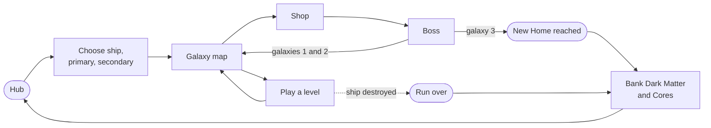
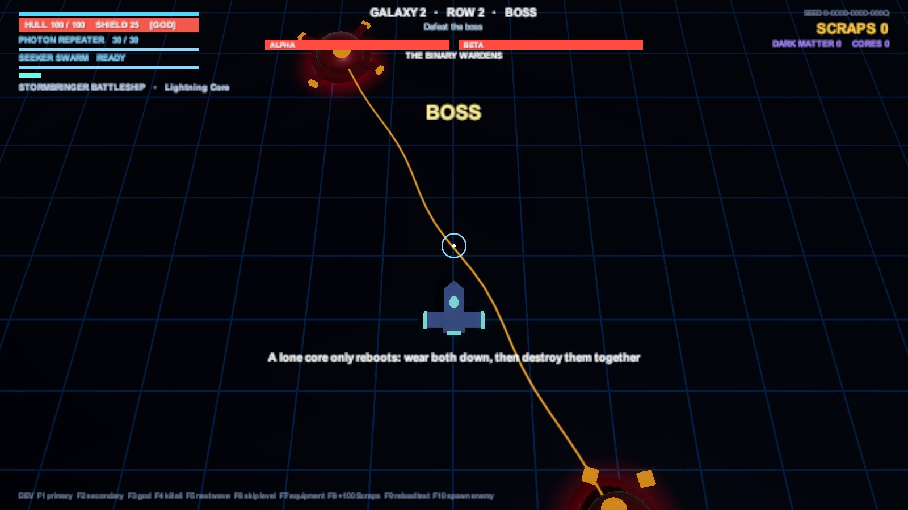

# How to play

[Docs home](../README.md) › [Game reference](README.md) › How to play

*Project Pathfinder* is a top-down twin-stick roguelite: you move with one stick, aim with the other, and try to cross
three galaxies in one run. When the ship is lost, the run ends, but what you banked makes the next run stronger.

## Controls

| Action | Keyboard & mouse | Gamepad |
|---|---|---|
| Move | WASD / arrows | Left stick |
| Aim | Mouse | Right stick |
| Fire primary (hold; hold and release to charge the Quantum Charger) | Left mouse | Right trigger |
| Fire secondary | Right mouse | Left trigger |
| Dash (invulnerable while dashing) | Space | A / Cross, RB |
| Reload | R | X / Square |
| Interact (stations, restart after a run) | E | Y / Triangle |
| Pause menu (options, controls, abandon run) | Esc | Start |
| Galaxy map: choose a node | Left / Right + Enter, or click | D-pad / stick + A |

Movement and aim are independent: the ship faces where you aim. The dash goes the way you're moving, or the way
you're aiming if you're standing still.

## A run

1. **In the Hub**, choose **Start Run**, then a ship, a primary and a secondary weapon. (Or choose **Survival**: one
   arena against the clock, with an upgrade every minute. See [Survival](survival.md).)
2. **On the galaxy map**, pick a node from the bottom row. Each row narrows toward the **Shop** and the **Boss** at the
   top. Node types are shown, except Mystery (?) nodes. See [Run structure](run-structure.md).
3. **In a level**, complete the objective (clear the waves, harvest Dark Matter, use the station...), then fly into
   the **cyan wormhole** at the top to leave. Your hull carries over between levels; your shield refills and your
   secondary weapon is ready again.
4. **Collect Scraps** (gold) from enemies and spend them in the Shop before the boss. Leftover Scraps fly to you when a
   fight is won.
5. **Beat the boss** to earn Singularity Cores, a full repair and a Rare-or-better item. Then the wormhole pulls you
   into the next galaxy.
6. **When the run ends**, win or lose, the Dark Matter and Cores you earned are banked, plus 10% of the Scraps you
   collected. Spend them in the **Pathfinder Lab**. See [Economy & meta](economy.md).

## Reading the screen

- **On your ship:** a ring around it shows your ammo (it drains as you fire and refills orange while reloading), and
  small bars under it show shield (blue) and hull (red). It stays faint until it matters, so you never need to look
  away from your ship.
- **Top left:** hull (red) and shield (blue), your weapons with ammo and cooldown (and charges, for a secondary with
  more than one), dash charges and your ship's trait.
- **Bottom left: your ship and its equipment slots.** Weapon mods sit at the nose, the secondary mod on the left wing,
  hull systems down the right side and the dash module at the engine. A slot shows its item and level, or a faint **+**
  when it's free. In the Shop or on a choice card, point at an item and the ship shows where it would go: a free slot
  glows green, an item you'd level up glows green, and a full group glows gold, which means you'd have to swap one out.
- **Top right:** Scraps, Dark Matter, Singularity Cores and the run's seed code.
- **Top centre:** where you are, the objective, and the boss's health bar (one per part for a boss in pieces).
- **Crosshair:** its ring shows your ammo, reload or charge.
- **A red flash at the screen edges** means your hull was hit.

### Danger at a glance

| You see | It means |
|---|---|
| Magenta shots with a dark outline | Enemy bullets: darts, spinning stars, glowing rocks, crystal shards or green-glowing seeds, depending on who fired. Dodge or dash through. |
| An enemy's accent lights flaring white-orange | It's winding up an attack. Each type has its own warning sound. |
| A lane of red chevrons on the floor | Something is about to charge along it. |
| An outlined area on the floor, filling in | That area is about to be hit (a flame cone, a slam ring). Get out before it fills. |
| A thin, flickering red line | An Arc Drone has locked on. Step off the line. |
| A grey spark when you shoot something | Armour: no damage. Look for yellow. |
| Anything yellow on an enemy | A weak point. Shoot it. |

## Tips

- The dash makes you **fully invulnerable** for its duration. Dash *through* bullets and attacks, not just away.
- Your hull **doesn't regenerate**, and your shield only refills after 5 s out of harm. Repairs are rare: the Repair
  node, the Shop, boss rewards and some events.
- Every route is a trade. Equipment nodes grow your build, Scraps nodes fund the Shop, Dark Matter nodes invest in
  future runs.
- In a Dark Matter level, the exit is open from the start. Greed is a choice: the longer you stay, the harder it gets.

## Options

Options are in the Hub and the pause menu: **Language**, **Master / Music / Effects volume**, **Sound in background**,
**Screen shake**, **Fullscreen**, and an **FPS counter**. They are saved on this machine.

- **Volumes and screen shake are sliders:** drag them, or click the row to step up 10% and right-click to step down.
  Left and Right on the keyboard or gamepad step them too.
- **On/off options are tickboxes:** click or press Enter to toggle.
- **Sound in background** keeps the music and sounds playing when you switch to another window. Either way, switching
  away mid-fight pauses the game.
