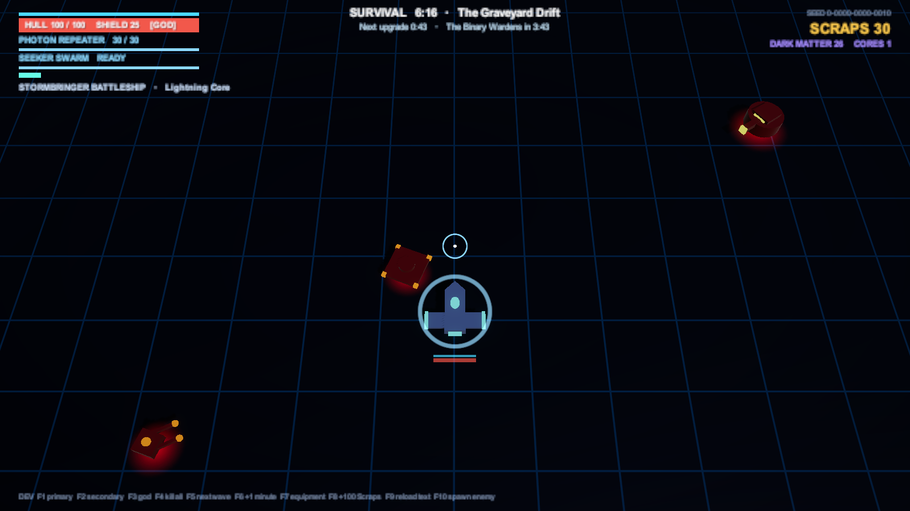
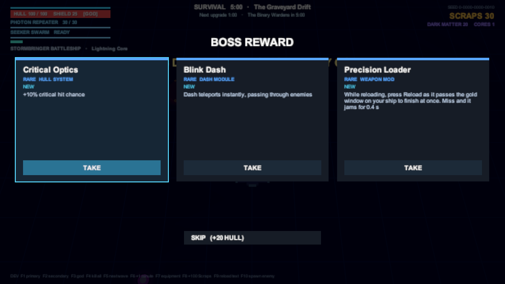

# Survival

[Docs home](../README.md) › [Game reference](README.md) › Survival

One arena, endless waves, and a clock. You get an upgrade every minute and face a guardian every five minutes. Defeat
all three guardians to win, or see how long you last. Survival replaced the Combat Sandbox in the Hub after the first
external playtest asked for a "survive X minutes" mode with upgrades. ([GDD §3.2](../GDD.md#32-survival-mode))

## Starting

In the Hub, choose **Survival**, then a ship, a primary and a secondary, just as for a run. Your Pathfinder Lab
upgrades apply. The Hub shows your best time under the Survival entry.

## The clock

- **Every minute**, the fight pauses for a choice of three items (plus your ship's bonus choices). **Skipping repairs
  20% of your hull**: there's no Shop to spend Scraps in.
- **Every five minutes** a guardian arrives, announced 3 seconds ahead. It appears at the top of the arena, or at the
  bottom if you're up there.
- **The clock stops while a guardian is alive.** The waves don't stop, but they thin out to about a third.
- When a guardian falls, you get its Singularity Cores (1, 2, then 3), a 30% repair, your Scraps pulled in, Last Stand
  re-armed, and a **Rare-or-better item**. That reward replaces the upgrade due the same minute. The waves then switch
  to the next galaxy's enemies, rarity odds and music.
- **The Hive Matriarch's fall wins.** Her Swarm and every remaining enemy die with her.

## The pressure

The difficulty follows the clock, not the wave count, so clearing waves fast doesn't make the game harder.

| On the clock | Wave budget | Enemy health | Elite chance | Enemies |
|---|---|---|---|---|
| 0:00 | 6 | ×1.0 | 3% | The Shattered Expanse |
| 5:00 | 16 | ×1.6 | 10.5% | The Graveyard Drift (after the Maw) |
| 10:00 | 27 | ×2.4 | 18% | The Veil Nebula (after the Wardens) |
| 15:00 | 38 | ×3.2 | 25.5% | |

- Health and budget grow smoothly between those points.
- A wave comes when 80% of the last one is dead, or after 15 seconds. No timed wave starts while 45 enemies are alive.
- Guardians always have their own galaxy's health, as in a run: the Maw ×1.0, the Wardens ×1.6, the Matriarch ×2.4.

## Rewards

You earn rewards whether you win, die or leave from the pause menu:

- **Dark Matter** for every minute on the clock: 4 a minute before the first guardian, 6 after it, 8 after the second.
  A full 15 minutes pays 90.
- The guardians' **Singularity Cores**: 6 for all three.
- **10% of the Scraps** you collected, as Dark Matter.
- Your **best time**.

Survival doesn't count as a run in the Hub's "runs won / played" statistics.

## Tuning

Everything above is in `Assets/_Project/Data/Run/SurvivalConfig`. The guardians, their health by galaxy, their cores
and the 30% repair come from `RunConfig`, shared with the campaign. In a development build, **F6** moves the clock on a
minute.
