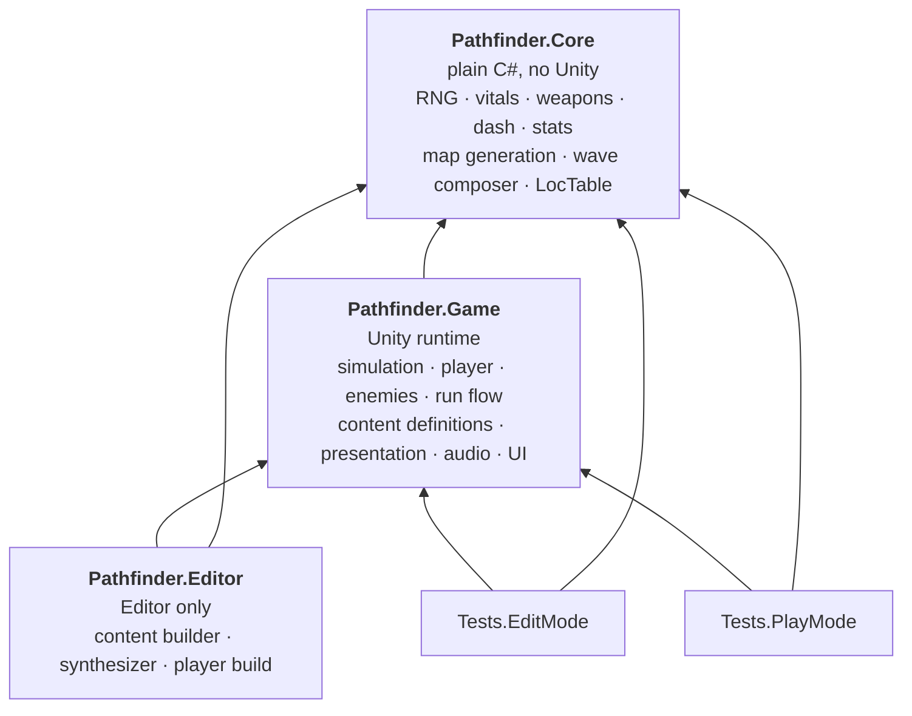
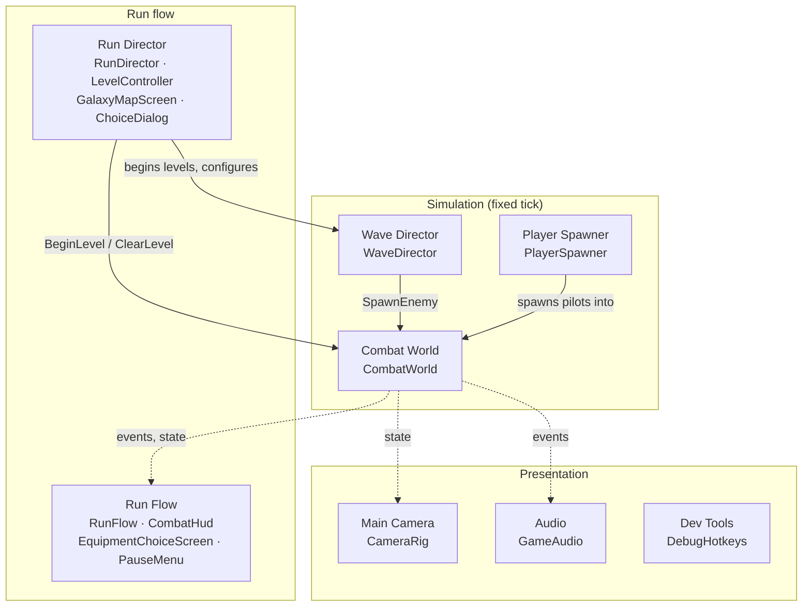
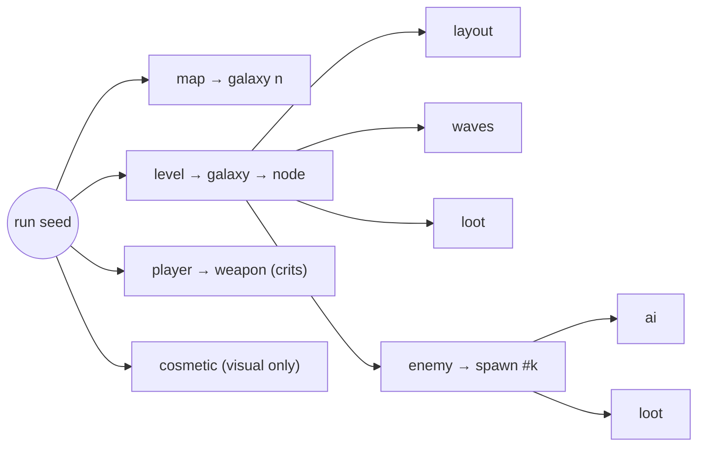

# Architecture

[Docs home](../README.md) › Technical › Architecture

How the code is organised, and the rules it follows. The rules come from three goals: combat that feels exact, runs
that replay from a seed, and online co-op later without a rewrite ([GDD §14](../GDD.md#14-technical-design-for-the-build-phase)).

## Core principles

1. **A deterministic, fixed-tick simulation.** All gameplay advances on a 60 Hz tick in one place, `CombatWorld`, in a
   fixed order. Gameplay never reads `Time.deltaTime` or the frame rate. Collisions are circles on a flat plane,
   with swept projectiles, so there is no physics engine to drift. → [Simulation & combat](simulation.md)
2. **Simulation and presentation are separate.** Gameplay state lives in plain components updated on the tick.
   Visuals, audio and UI *read* that state or listen to events, and never change it. Transforms interpolate between
   ticks so motion is smooth at any frame rate. → [Presentation](presentation.md)
3. **Seeded randomness only.** Every random draw comes from our own PCG32 generator, seeded from the run seed through
   a tree of labelled sub-seeds. `UnityEngine.Random` is allowed only for presentation (pitch jitter, particle
   wobble). The same seed always gives the same map, levels, waves and loot.
4. **Co-op ready from day one.** No player singletons, input as commands, and an authority boundary around every
   outcome. Single-player is simply "one local player who is also the authority".
5. **Data-driven content with stable IDs.** Ships, weapons, enemies, items, events and upgrades are ScriptableObject
   definitions, each with a string ID. Saves and (later) network messages use IDs, never object references.
   → [Content pipeline](content-pipeline.md)
6. **Pure rules in a Unity-free core.** Anything that can be plain C# (RNG, vitals, weapons, dash, stats, map
   generation, the wave composer, the text parser) lives in `Pathfinder.Core`, which doesn't reference Unity, so it is
   fast to unit-test.
7. **Generated placeholder content.** The content builder creates every prefab, material, effect, sound and music loop
   from code, so the game runs with no third-party assets and the look stays consistent with the readability rules.
8. **Every player-facing string is localized.** Text comes from `.loc` files through `Loc.T(key)`. A test fails if
   the code asks for a key that isn't in English.
9. **Tests drive the real game.** PlayMode tests load the real scenes and fly the real ship with scripted commands.
   → [Testing](testing.md)

## Assemblies



The arrows point at what each assembly depends on. `Core` depends on nothing, so a rule that lives there can't
accidentally touch the scene.

## Folders

```
Assets/_Project/
  Scripts/Core/          Pure rules (namespace Pathfinder.Core.*)
    Combat/              Vitals, MagazineWeapon, ChargeWeapon, Cooldown, DashState, WaveComposer
    Equipment/           StatSheet (stats and modifiers), EquipmentSlots, EquipmentRoller (offers)
    Localization/        LocTable: the .loc parser and placeholder formatter
    Meta/                MetaState: the persistent profile
    Random/              IRandom, Pcg32, Seed (labelled sub-seeds), RunSeed (shareable codes)
    Run/                 GalaxyMap, GalaxyMapGenerator, RunState
  Scripts/Game/          Unity runtime (namespace Pathfinder.Game.*)
    Simulation/          GameClock (pause holders), Authority, PlaneMath, SimInterpolation
    Combat/              CombatWorld (the tick), CombatEntity, CombatRegistry, ProjectileSystem, PickupSystem
    Player/              PlayerShip, ShipCommand, LocalInputCommandSource, PlayerSpawner, PrimaryWeapons
    Enemies/             Enemy (the body), one *Brain per behaviour, WaveDirector, telegraph interfaces
    Equipment/           EquipmentDefinition and EquipmentEffect, one class per behaviour item
    Content/             The other definitions: ships, weapons, enemies, elites, events, wave configs, ContentDatabase
    Run/                 RunDirector, LevelController, RunConfig, RunSession, RunFlow, MysteryEvents, RunLog
    Meta/                MetaProgression (save file), MetaUpgradeDefinition
    Presentation/        HUD, menus, camera, entity visuals, telegraph visuals; Ui/ holds the uGUI kit
    Audio/               GameAudio (sound director), SoundLibrary (cues to clips)
    Localization/        Loc: the game's text lookup
    Settings/            GameSettings (PlayerPrefs)
    Dev/                 DebugHotkeys
    Boot/                Bootstrapper, SceneNames
  Scripts/Editor/Setup/  ContentBuilder (partial classes by area), Synth, ProjectSetup
  Scripts/Editor/Build/  PlayerBuild
  Tests/EditMode/        Unit tests for Core and Game helpers, content checks, localization coverage
  Tests/PlayMode/        Scene tests with scripted pilots, balance probes, screenshots
  Data/                  ScriptableObject definitions (tuning lives here)
  Prefabs/, Art/         Generated by the content builder
Assets/StreamingAssets/Localization/   en.loc and other languages
```

## How a scene is put together

The Run scene, as wired by the content builder. The Sandbox has the same core without the run objects. Survival has
the same core too, with a `SurvivalController` in place of the run director and level controller. The Hub has only the
menu, audio and camera.



| Object | Responsibility |
|---|---|
| **CombatWorld** | Owns the tick, the arena bounds, the projectile and pickup systems, and the level seed. Spawns enemies with their own seeded random streams. |
| **WaveDirector** | Buys waves of enemies from a budget ([§7.2](../GDD.md#72-wave-director)). Endless in the Sandbox, a fixed wave count in levels. |
| **PlayerSpawner** | Spawns the pilot ship(s) with the run's loadout and binds local input. |
| **RunDirector** | The run's state machine: map, level, galaxy cleared, victory, defeat. Banks rewards and writes the run log. |
| **LevelController** | Runs one level: its objective, rewards, exit wormhole, Shop, Repair station, events and boss. |
| **RunFlow** | Pausing (single-player only) and what happens when the run ends. |
| **CombatHud, menus** | Read-only views built in uGUI from code. |
| **GameAudio** | Plays sound cues in response to combat events and calls from gameplay. |

## Determinism and seeds

A run has one 64-bit seed. Everything random derives from it by hashing labels into child seeds, so each consumer has
its own independent stream ([§14.3](../GDD.md#143-randomness)).



What this buys:

- **A node always plays the same**, whatever route led to it, because its seed depends only on its position.
- **One system can't shift another**: drawing an extra loot roll never changes the next wave.
- **Bugs reproduce** from a seed code shown on the HUD and in the run log.
- **Co-op clients can generate identical maps** from a shared seed.

Rules for code:

- Draw only from a stream you own (`enemy.Random` in a brain, the level's `layout` stream in the level controller).
- Never use `UnityEngine.Random` or `System.Random` for gameplay. Presentation may use `UnityEngine.Random`.
- Never iterate a `HashSet` or `Dictionary` to make a gameplay decision: their order isn't stable.

## Co-op readiness

Local co-op is built (M8, see below), and these rules keep online co-op possible ([§14.4](../GDD.md#144-co-op-readiness)):

| Rule | In the code |
|---|---|
| No player singletons | `CombatRegistry.Players` holds 1 to N ships. Enemies target `CombatRegistry.NearestLivingPlayer`. |
| Input becomes commands | Ships never read devices. An `IShipCommandSource` returns a `ShipCommand` each tick: `LocalInputCommandSource` for a person, scripted sources for tests and bots, a network peer later. |
| An authority boundary | Damage, deaths, spawns, loot and currency changes check `Authority.IsAuthority` (always true for now). |
| Events, not reaching in | Presentation subscribes to `CombatEvents` and entity events instead of being called by gameplay. |
| Stable IDs | Content by string ID; spawned entities get a runtime `EntityId` from the registry. |
| No global time tricks | Pausing goes through `GameClock.Pause(holder)`, never `Time.timeScale`. Co-op will ignore single-player pauses. |
| Per-player UI | The HUD binds to each local pilot: a panel, a readout on the ship and a crosshair each. |

### Local co-op (M8)

- **Who's playing:** `LocalPlayers` (static, kept across scenes) holds up to four slots, each with its `Controls`
  (`Any` for player 1 alone, `KeyboardMouse`, or `Gamepad` with that controller's devices: one pad can show up as
  several), its `PilotLoadout` and its paint (`LocalPlayers.PaintOf`, an index into `PilotPaint.All`; no two players
  share one, and `GameSettings` remembers each player number's). `LocalPlayers.DevicesFor(index)` is the device list a player's controls listen to;
  null means every device. Assign a null list as `null`, never as a null array: an array converts to an empty device
  list first, and the pilot hears nothing (playtest 8). The Hub assigns controls by press (`HubMenu.ListenForJoin`,
  `ListenForControls`) and logs every device and assignment to the player log (`[Input]`, `[Controls]`).
- **Input:** each `LocalInputCommandSource` instantiates its own copy of the project's input actions and sets
  `InputActionAsset.devices`, so two pilots never read each other's sticks. Menus do the same on demand:
  `MenuInput.RestrictTo(devices)` (see `PilotLabels.Devices(pilot)`). The shared actions still serve Pause, which any
  device can press.
- **Spawning:** `PlayerSpawner` spawns one ship per slot, side by side (`CoopRules.EntryOffset`). Players 2+ share
  player 1's `ScrapWallet`, and each gets a `PilotMarker` ring.
- **Rules:** `CoopRules` holds the numbers: revive time, radius and hull, scaling; `CoopRules.PilotColor` is each pilot's paint. `ReviveSystem` runs in
  the world's tick. `CombatWorld.SpawnEnemy` and `WaveDirector` scale by `CombatRegistry.Players.Count`.
- **In turn:** `PilotOrder.StartingWith(pilot)` is the order for things each pilot gets: equipment picks, Survival
  upgrades.

## Patterns you'll see everywhere

- **Definition plus runtime object.** A ScriptableObject holds tuning; a runtime class does the work. Equipment
  definitions create an `EquipmentEffect` per pilot; enemy definitions point at a prefab whose brain holds behaviour
  tuning.
- **Body plus brain.** Every enemy is the same `Enemy` component (health, steering, separation, contact damage, loot)
  plus one `EnemyBrain` that decides what it wants each tick. See [Simulation & combat](simulation.md#enemies).
- **Small interfaces between gameplay and visuals.** A brain implements `IChargeTelegraph`, `IAreaTelegraph`,
  `IBeamTelegraph`, `ISinkDepth` or `IMultiPartBoss`; a presentation component reads it. The brain never knows how it
  is drawn.
- **Pause holders.** Anything that pauses (a menu, an equipment choice) registers itself with `GameClock` and
  unregisters when done, so overlapping pauses can't unpause each other.
- **`[field: SerializeField]` properties.** Definitions expose tuning as read-only properties backed by serialized
  fields. The builder sets them through `<Name>k__BackingField`.
