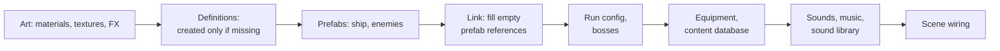

# Content pipeline

[Docs home](../README.md) › Technical › Content pipeline

Where content comes from: definitions you tune, a builder that generates everything else, a database that finds
things by ID, text files for every word on screen, and a sound library.

## Content definitions

Every piece of game content is a ScriptableObject that derives from `ContentDefinition`, which gives it:

- **`Id`**: a stable string such as `enemy.crusher` or `equipment.kill-refund`. Saves, loadouts and tests refer to
  content by ID. An EditMode test fails on missing or duplicate IDs.
- **`DisplayName`**: looked up as `{id}.name` in the text files, falling back to the name typed on the asset.

| Definition | Folder in `Data/` | Holds |
|---|---|---|
| `ShipDefinition` | `Ships` | Hull, shield, speed, dash, trait |
| `PrimaryWeaponDefinition` | `Weapons` | Fire mode, damage, rate, magazine, spread, range, projectile visuals |
| `SeekerSwarmDefinition`, `NovaPulseDefinition` | `Weapons` | Secondary weapons (each type has its own class) |
| `EquipmentDefinition` and subclasses | `Equipment` | Category, rarity, per-level values, the effect it creates |
| `EnemyDefinition` | `Enemies` | Health, speed, contact damage, budget cost, Scraps drop, knockback multiplier, prefab |
| `EliteModifierDefinition` | `Enemies` | Health, speed, attack-rate and size multipliers, marker |
| `WaveDirectorConfig` | `Waves` | The enemy pool (weight, first wave, first galaxy), budget curve, elite odds, pacing |
| `RunConfig` | `Run` | Level-type tuning, rewards, Shop prices, each galaxy's boss |
| `MysteryEventDefinition` | `Events` | Choices, requirements, odds, outcomes |
| `MetaUpgradeDefinition` | `Meta` | Currency, cost per tier, effect (stat bonus, starting Scraps, unlock) |
| `ContentDatabase` | `Data/` | The index of all of the above, by ID |

Behaviour tuning that only one enemy has (a Lancer's charge speed, the Quarry Maw's phases, a Warden's orbit) lives on
the **brain component** in the enemy's prefab, not on the definition.

> [!NOTE]
> Definitions expose tuning as read-only properties: `[field: SerializeField] public float MaxHealth { get; private set; }`.
> The inspector shows them normally. In code and the builder, the serialized field is `<MaxHealth>k__BackingField`.

## The content builder

`Pathfinder › Setup › Build Content` (or `ContentBuilder.BuildBatch` from the command line) generates the game's
placeholder content in one pass. It is split into partial classes by area under `Assets/_Project/Scripts/Editor/Setup`:

| File | Builds |
|---|---|
| `ContentBuilder.cs` | The build order, material and texture helpers, object helpers |
| `ContentBuilder.Art.cs` | Materials, textures, effects (impacts, explosions, telegraphs), projectile visuals |
| `ContentBuilder.Data.cs` | Ship, weapon, enemy and elite definitions, the wave pool, one-off upgrades of older assets |
| `ContentBuilder.Actors.cs` | The player ship and the five galaxy 1 enemy prefabs |
| `ContentBuilder.Galaxy2.cs` | Galaxy 2's enemies, the Binary Wardens, their effects and floor telegraphs |
| `ContentBuilder.Boss.cs` | The Quarry Maw (head, segments, telegraphs) and the Lab upgrades |
| `ContentBuilder.Equipment.cs` | All equipment items, ship traits and the content database |
| `ContentBuilder.Events.cs` | The Mystery events |
| `ContentBuilder.Run.cs` | Run objects (wormhole, crystals, stations, cache) and the run config |
| `ContentBuilder.Audio.cs`, `.Music.cs`, `Synth.cs` | Synthesized sound effects and music, and the sound library |
| `ContentBuilder.Scene.cs` | Wires the Sandbox, Run and Hub scenes |



### What it keeps and what it replaces

| Rebuilt every time | Created once, then left alone |
|---|---|
| Materials (updated in place, so GUIDs and references survive) | Content definitions and their tuning |
| Textures, effect and projectile prefabs, enemy and ship prefabs | Sound library mix settings (volume, voices, interval, pitch jitter) per cue |
| Sound effect and music WAV files | Prefab references a designer set on a definition (`SetIfEmpty`) |
| Scene wiring | |

Because definitions are only created when missing, a value added to the builder later doesn't reach an existing
asset by itself. Two patterns handle that:

- **One-off upgrades** (`Upgrade`, `AddGalaxyTwoEnemies`, `AssignGalaxyBosses`) change a field only if it is still at
  its old default, so they never undo tuning.
- **Editing the asset** in the inspector (or its YAML) for a straight tuning change.

The builder also checks its work: `RequireReferences` fails the build if a scene component has an empty reference
that isn't marked optional.

## The content database

`Data/ContentDatabase.asset` lists every ship, weapon, item, upgrade, event and enemy (bosses included). It is
regenerated on each build, so it is always complete. Runtime code finds content with `FindShip(id)`,
`FindEquipment(id)`, `FindEnemy(id)` and so on: the Hub loadout, the save file, debug tools (F7, F10) and tests all go
through it.

## Text and translations

Every player-facing string comes from `Assets/StreamingAssets/Localization/<language>.loc`
([GDD §12.5](../GDD.md#125-localization)).

```ini
@language = English

# Comments start with #
hud.scraps = SCRAPS {amount}
hud.boss.rebooting = {name}   ·   OFFLINE, REBOOTING {seconds:0.0}s
enemy.crusher.name = Crusher
boss.binary-wardens.hint = A lone core only reboots: wear both down, then destroy them together
```

- **Lookup:** `Loc.T("hud.scraps", ("amount", 40))`. Placeholders are named and can carry a number format.
- **Content keys** follow the ID: `{id}.name`, `{id}.desc` (item descriptions), `{id}.trait` and `{id}.trait.desc`
  (ships), `{id}.body`, `{id}.choice.N`, `{id}.result.N`, `{id}.fail.N` (events), and `{id}.hint` (bosses).
- **Fallbacks:** a key missing in another language uses English. A key missing in English shows as `[key]` and logs
  a warning once. Content without a key falls back to the text on its asset.
- **Languages:** every `.loc` file in the folder appears under Options › Language. F9 reloads the files in play mode.
- **Safety net:** `LocalizationCoverageTests` scans the game code for key literals, checks built keys (level types,
  stats, rarities, controls), every content item's text and every galaxy boss's hint, and that `en.loc` parses
  without warnings.

## The sound library

Gameplay never references audio clips. It asks for a **cue**, `GameAudio.Play(SoundCue.Zap, position)`, and
`Data/Audio/SoundLibrary.asset` maps each cue to a clip with its mix settings:

| Setting | Effect |
|---|---|
| Volume | Base level of the cue |
| Pitch jitter | Random pitch variation per play, so repeats don't machine-gun |
| Min interval | Seconds before the cue can play again |
| Max voices | Copies playing at once; the oldest makes way |

The clips are synthesized by `Synth.cs`: oscillators and noise with pitch sweeps, envelopes and a sweeping low-pass
filter, written as 16-bit WAVs. Music is composed the same way (`ContentBuilder.Music.cs`). Replacing a placeholder
with a real recording means pointing the library entry at a new clip; no code changes.

> [!WARNING]
> `SoundCue` values are stored as integers in the library. **Always add new cues at the end of the enum**, or every
> entry after the insertion point plays the wrong sound.
