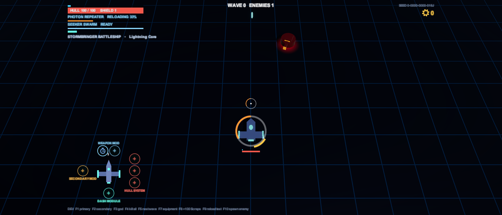

# Presentation: UI, visuals, camera and audio

[Docs home](../README.md) › Technical › Presentation

Everything the player sees and hears. The one rule: **presentation reads gameplay state and listens to events, and
never changes the simulation.** That keeps the game deterministic and makes the views safe to rework.

## UI: uGUI built from code

There are no hand-made UI prefabs. Each screen builds its own uGUI hierarchy once, in code, and refreshes it each
frame or on change.

| Piece | Role |
|---|---|
| `UiKit` | Creates canvases (1920 × 1080 reference, scaled to fit), text, images, panels, layout groups; holds the colour theme and generated sprites (ring, circle, vignette) |
| `UiRow` | A selectable menu row: accent stripe, optional icon, bold label, right-aligned note (price or state, optionally with a small icon such as the Scraps cog), wrapping detail line |
| `UiBar` | A filled bar with a track, for hull, shield, ammo, cooldowns and boss health |
| `UiPointer` | Mouse hover, click and right click on any element |
| `UiScrollList` | A list of rows that grows with its content up to a height limit, then scrolls with a slim scrollbar; menus scroll it to keep the keyboard selection in view |
| `UiSlider` | A draggable 0–1 slider (track, fill, handle) that snaps to steps; takes its own left clicks, passes right clicks to its row |
| `MenuInput` | Keyboard and gamepad navigation with key repeat, Submit and Cancel, each with its menu sound; works while paused |
| `ModalScreens` | Tracks open menus. `AnyOpen` brings the cursor back; `BlocksPause` stops Esc from closing a menu *and* opening the pause menu in the same frame |
| `SettingsOptions`, `OptionRows` | The options shared by the Hub and the pause menu (language, volumes, sound in background, screen shake, fullscreen, FPS), each a choice, a slider or a tickbox, and the builder that makes their rows the same way in both menus |

Layout groups size rows and cards to their text, so descriptions wrap instead of being cut off, and long lists scroll:
the Hub, the pause menu and the dialogs never grow past a 1080-unit-high screen.
Every string goes through `Loc.T`, and menus rebuild when the language changes (`Loc.Changed`).

### The screens

| Screen | Where | What it shows |
|---|---|---|
| `HubMenu` | Hub | Start Run and Survival (ship, primary, secondary), Pathfinder Lab, Options |
| `GalaxyMapScreen` | Run | The node graph; walked path in cyan, open lanes white, next nodes pulse |
| `ChoiceDialog` | Run | Repair station, Shop (Catalog, Upgrades, Services) and Mystery events |
| `EquipmentChoiceScreen` | Run, Survival | A row of item cards, plus the swap step when a category is full. The skip row pays Scraps, or does what the caller asks (Survival repairs) |
| `PauseMenu` | Run, Survival, Sandbox | Resume, options, controls, abandon run (leave Survival) |
| `CombatHud` | Run, Survival, Sandbox | See below. In Survival its top centre shows the clock, the next upgrade and guardian, and the guardian's bar |

### The HUD

`CombatHud` binds to the local pilot:

- **On the ship:** an ammo/reload ring around it (charge for the Quantum Charger, the Precision Loader's gold window
  while reloading) and shield and hull bars under it. It's anchored at the ship's viewport position, so it lines up at
  any resolution, and fades to 45% while all is well.

- **Corner panels** live in a centred 16:9 area (`SafeAreaFitter`), so on ultrawide screens they stay near the action.

  

- **Top left:** hull and shield bars, primary weapon state and ammo gauge, secondary cooldown (with a charge count
  and the time to the next charge when it has several), dash charges and the ship's trait.
- **Bottom left:** `ShipSlotsView`, the ship (`UiKit.Ship`, drawn in code) with its equipment slots around it, each
  category in its HUD colour: filled slots show the item's icon and level, free ones a faint plus. It's on its own canvas
  (sorting order 35, above the map, the Shop and the choice cards, below the pause menu), so it stays lit while you shop.
  Menus report the item they point at through `EquipmentPreview`, and the diagram shows where it would go (`SlotState`:
  a free slot to fill, an item to level up, a full category to swap from, the slot a swap would replace).
- **Top right:** Scraps, Dark Matter and Singularity Cores, the seed code and an optional FPS counter.
- **Top centre:** galaxy, row and level type; the objective; the boss bar with phase marks, or **one bar per part**
  for a boss that implements `IMultiPartBoss` (each named inside its bar, with a reboot countdown when a part is down).
- **Centre:** banners, prompts (including each boss's opening hint), and the crosshair, whose ring shows ammo, reload
  or charge.
- **Edges:** a red vignette flash when the hull is hit.
- **Overlays:** galaxy cleared, victory and run over, with the run summary and banked rewards.

## Visuals

The art is generated primitives with emissive materials, bloom and a consistent colour language
([readability rules](#readability-rules)).

| Component | Does |
|---|---|
| `EntityVisual` | Flashes white on hits, brightens glow parts while an enemy telegraphs (or the ship charges a shot), blinks during post-hit invulnerability, draws the dash trail, spawns the death explosion, hides burrowed enemies |
| `TelegraphLine` + `ChevronLane` | A lane of chevrons along a charge path that fills in as the wind-up completes (Lancer, Quarry Maw sweeps) |
| `AreaTelegraph` | A floor outline at an attack's reach with a fill growing out to it, flickering just before it lands; builds cone or circle meshes from the brain's arc (Scorcher, Crusher, Warden reboot ring) |
| `BeamTelegraph` | A thin, flickering line along a locked beam path that thickens before it fires (Arc Drone) |
| `ArcBolt` | A jagged lightning bolt that crackles and fades (Arc Drone zap) |
| `ImpactTelegraph` | Where something is about to hit the floor (the Quarry Maw's eruption, a Matriarch spore pod): a crisp outline drawn as geometry, a fill growing out to it and a ring closing in to meet it, flashing once the spot locks; optionally the projectile arcing in |
| `SporeCloud` | A spore cloud: a translucent area with a crisp, breathing edge, churning fog and spores drifting up; pops in, fades out over its last moments |
| `RingLine` | A constant-width circle drawn as a line, so it stays thin as it grows (the Matriarch's bloom pulse) |
| `WardenVisual` | A Warden core's spin, its glow going dark when offline, and the Alpha's crackling tether |
| `SinkVisual` | Lowers a model into the floor with a shudder (burrowing Maw, offline Warden core) |
| `RingPulse`, `SimpleMotion`, `MuzzleFlash`, `TimedDestroy` | Small one-job effects: expanding rings, spin and pulse, muzzle flashes, self-cleanup |

Each telegraph component reads a small interface implemented by the enemy's brain (`IChargeTelegraph`,
`IAreaTelegraph`, `IBeamTelegraph`, `ISinkDepth`, `IMultiPartBoss`). To give a new enemy a floor telegraph, implement
the interface on its brain and add the component in the builder; no visual code changes.

> [!TIP]
> Renderers that belong to a telegraph start **disabled** in the prefab. `EntityVisual` only flashes and hides the
> renderers that were enabled when it woke up, so a hit flash never turns a warning white.

## Camera

`CameraRig` follows the local pilots at a 60° pitch with a slight lead toward their aim, and stays inside the arena.
When a ship is placed at a level's entry (`PlayerShip.Placements` changes) it **cuts** to it instead of sliding.
It shakes on hull hits and big explosions, and other code can call `CameraRig.Kick(amount)` (an eruption, a slam, the
wormhole pull, which rumbles only while the pull is playing, never behind a paused menu). Kicks don't add up: the
strongest wins. Every shake is scaled by the **Screen Shake** setting, which
can turn it off.

## Audio

`GameAudio` is the sound director: one per scene, safe to call when absent.

- **Cues, not clips.** Gameplay calls `GameAudio.Play(SoundCue.X, position)`, or the director reacts to
  `CombatEvents` (damage, kills, shots fired, deflects, telegraphs) and player events (fired, dashed, Scraps).
- **Centred on the ship.** Sounds pan by which side of the local ship they happen on and get quieter with distance
  (full volume within 6 u, 30% at 32 u). Without a living ship, the camera is the centre.
- **Each enemy type winds up with its own sound**, chosen from its brain type, with pitch jitter.
- **Voice limits.** 28 pooled voices; each cue has a minimum interval and a voice cap, and the oldest copy makes way.
- **Music** is played by `MusicPlayer`, which survives scene loads: asking for the track already playing carries on
  instead of restarting. Each galaxy has its own track (`SoundLibrary.ForGalaxy`), on its map and in its levels;
  bosses have theirs; tracks crossfade over 1 s.
- **Volumes** multiply the director's own level by the player's master, effects and music settings.

See [Content pipeline](content-pipeline.md#the-sound-library) for the library and the synthesizer.

## Readability rules

Every colour and shape has one meaning, so a crowded screen reads at a glance
([GDD §12.4](../GDD.md#124-readability-rules)):

| Element | Look |
|---|---|
| Enemy bullets | White core, magenta body, dark outline, faint glow. Each shooter has its own shape (darts, stars, rocks, shards, seeds; `ContentBuilder.Bullets.cs`). Nothing else is magenta. |
| Enemies | Solid crimson bodies with red-orange accent strips over a red floor glow |
| Attack warnings | Accents flare white-orange; chevron lanes for charges; outlined floor areas that fill in; thin flickering beam lines |
| Hazards | Alpha-blended orange flames; white-and-orange lightning; an orange tether |
| The Swarm | Toxic green: the Matriarch's sacs, Broodling eyes, spore clouds, bloom pulses |
| Armour and weak points | Grey sparks mean no damage. Yellow always means "shoot here". |
| Player | Cyan and blue, elongated bolts. Enemies never use cyan. |
| Pickups | Gold Scraps, indigo Dark Matter |

Overlapping effects use alpha blending rather than additive glow where they can stack (bullets, flames), so dense
patterns don't blow out into glare.
