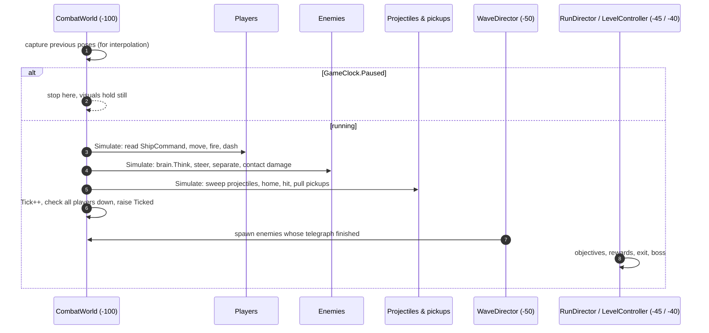
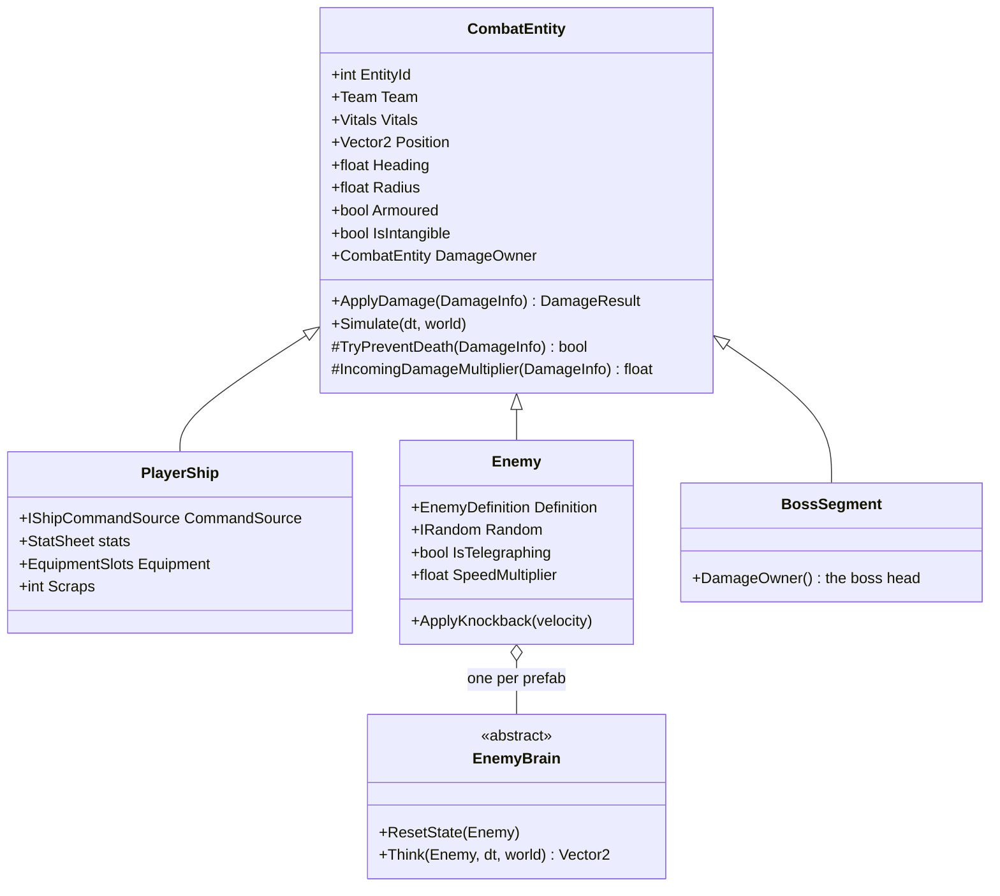
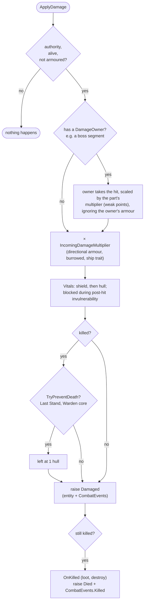
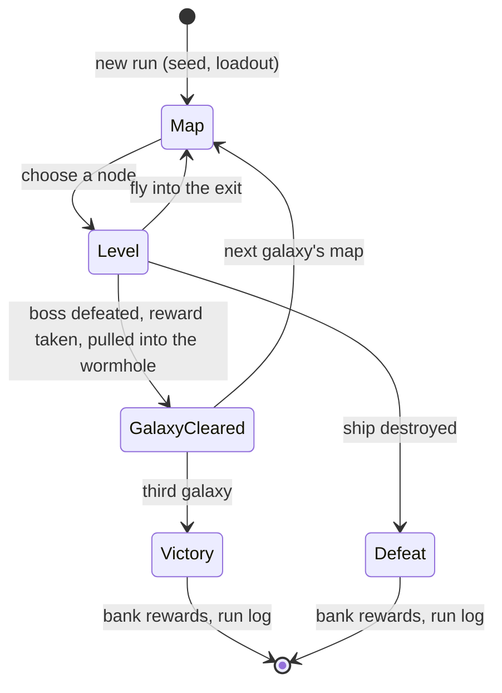

# Simulation & combat

[Docs home](../README.md) › Technical › Simulation & combat

Everything that decides the outcome of a fight runs here: the tick, entities, damage, projectiles, enemies, waves and
the run flow. For the design numbers, see [GDD §5–§7](../GDD.md#7-combat--enemies).

## The tick

Gameplay advances at a fixed **60 Hz** in `FixedUpdate`. Script execution order makes one fixed step run in a known
sequence:

- Players simulate before enemies, and both before projectiles, in registration order. The order is part of the
  determinism contract: don't depend on anything else.
- Between ticks, `CombatEntity.Update` interpolates each transform from its previous to its current pose with
  `SimInterpolation.Alpha`, and projectile and pickup visuals do the same in `LateUpdate`.
- **Pausing** never touches `Time.timeScale`. Menus call `GameClock.Pause(this)` and `GameClock.Resume(this)`; while
  any holder is registered, the world stops advancing but keeps capturing poses so nothing jitters.

## The plane

Gameplay is 2D on the XZ plane. `PlaneMath` converts between `Vector2` gameplay positions and world space
(`ToWorld`, `ToPlane`), turns headings into directions (`FromHeading`, `HeadingDegrees`, where 0° is +Z) and tests
swept circles (`SegmentHitsCircle`). The arena is 60 × 40 u centred on the origin; `CombatWorld.ClampToArena` keeps
bodies inside it.

## Entities

- **Registration.** Entities register with `CombatRegistry` in `OnEnable` and get a runtime `EntityId`. The registry
  lists players, enemies and both teams; there are no singletons.
- **Vitals** (in Core) hold hull and shield, shield regeneration, and post-hit invulnerability.
- **Intangible** entities (a dashing ship, a burrowed boss) are skipped by projectiles and contact damage.
- **Armoured** entities stop projectiles with a grey spark and take no damage.

## The damage pipeline

Every hit, from any source, goes through `CombatEntity.ApplyDamage`:

`DamageInfo` carries the amount, source team and entity, hit point, direction and a `DamageKind`: `Projectile`,
`Secondary`, `Contact`, `Proc` or `Burn`. **On-hit equipment effects only trigger for primary `Projectile` hits**, so
procs such as lightning and ricochets can never chain off each other.

### Hooks for special cases

| Need | Hook |
|---|---|
| Directional armour or a vulnerable state | The brain implements `IDamageModifier` (the Carrier's rear, the burrowed Quarry Maw). |
| Survive a lethal hit | The brain implements `IDeathGuard` (a Warden core going offline); for the ship, Last Stand's `TryPreventLethal`. |
| A body made of parts | Parts override `DamageOwner` and pass hits to the head (Quarry Maw segments). |
| Shell that deflects | Set `Armoured`; leave the weak parts unarmoured. |

## Projectiles

`ProjectileSystem` simulates every bullet as a plain struct, with pooled visuals that only follow.

- **Swept collision.** Each tick a projectile tests the segment from its old to its new position against opposing
  circles, so fast shots can't tunnel.
- **Pierce** passes through extra targets (each hit once), **homing** turns toward a target and retargets the nearest
  enemy when it dies, and **damage falloff** scales damage over range.
- **Armour.** A shot that hits armour stops with a spark. Weak points get 0.8 u of leniency: a shot that clips the
  shell that close to a weak point hits the weak point instead. Homing shots fly over armour to reach what they home on.
- **Defuse.** When a boss dies, `Defuse(Team.Enemy)` turns every enemy bullet harmless; they slow, shrink and vanish
  over half a second.
- **Quiet** projectiles raise no fired event, so a stream (the Scorcher's flames) doesn't spam the shot sound.
- **Visual growth** scales a projectile's visual over its range (flames billow out).

Spawn one with `world.Projectiles.Spawn(new ProjectileSpawn(...))`. Optional arguments cover pierce, falloff, homing,
target, visual scale, damage kind, quiet and growth.

## Pickups

`PickupSystem` handles Scraps: bursts that settle on the floor, accelerate into a ship within its magnet radius, blink
before they expire, and are collected by the authority. **Vacuum** mode (set when a fight is won) ignores the radius
and lifetime and pulls every Scrap to the nearest ship.

## The player ship

Each tick `PlayerShip.Simulate` reads a `ShipCommand` from its `CommandSource`: move, aim, fire primary, fire
secondary, dash, reload and interact. Weapons, the dash and equipment effects run from there. The ship's stats come
from a `StatSheet`: base values from the ship definition, then every modifier from its trait, equipment levels and run
effects, as `(base + Σ flat) × (1 + Σ percent)`. The sheet is rebuilt from scratch whenever the loadout changes.

Equipment effects hook into the ship's events: shot fired, primary hit, kill, dash start and end, bullet phased
through, lethal hit and level start. See [Extending the game](extending.md#add-an-equipment-item).

## Enemies

Every enemy is one `Enemy` body plus one `EnemyBrain`:

| `Enemy` (shared body) | `EnemyBrain` (behaviour) |
|---|---|
| Health from the definition, scaled by galaxy and elite | `ResetState(self)` when spawned |
| Steering with acceleration, separation from other enemies | `Think(self, dt, world)` returns the desired velocity |
| Contact damage with a cooldown and bounce | Fires projectiles, sets `IsTelegraphing`, uses `self.Random` |
| Knockback (scaled by the definition's multiplier) | Can set `SpeedMultiplier`, `AccelerationMultiplier`, `ContactDamageMultiplier`, `Armoured`, `Burrowed` for this tick |
| Burn stacks, loot drop, death | Can implement `IDamageModifier`, `IDeathGuard` and the telegraph interfaces |

Multipliers reset to 1 at the start of each tick, so a brain only sets what applies *now*. Setting
`IsTelegraphing = true` raises `CombatEvents.Telegraphed` once, which the audio director turns into the type's wind-up
sound, and makes `EntityVisual` flare the enemy's accent lights.

The brains:

| Brain | Enemy | Pattern |
|---|---|---|
| `DroneBrain` | Drone | Chase and weave |
| `GunnerBrain` | Gunner | Keep distance, strafe, telegraphed 3-shot bursts |
| `SpinnerBrain` | Spinner | Drift, rotating bullet rings |
| `LancerBrain` | Lancer | Approach, wind-up with a chevron lane, charge, wind-down, joust again on a miss |
| `CarrierBrain` | Carrier | Slow turning tank that launches Drones; armoured front |
| `ScorcherBrain` | Scorcher | Approach, cone wind-up, flame spray, cooldown |
| `ArcDroneBrain` | Arc Drone | Strafe, lock a line, charge, instant zap |
| `CrusherBrain` | Crusher | Approach, ring wind-up, slam, recover |
| `QuarryMawBrain` | The Quarry Maw | Three phases; segmented body with weak points |
| `WardenBrain` | The Binary Wardens | Two linked cores, tether, offline and reboot |
| `MatriarchBrain` | The Hive Matriarch | Three phases; broods, spore clouds, charges, bloom rings; heart open between attacks |
| `BroodlingBrain` | Broodling | Weaving chase with darts |

## The wave director

`WaveDirector` spends a budget on enemies each wave ([§7.2](../GDD.md#72-wave-director)):

1. **Budget** = base × galaxy multiplier × row factor × wave factor, times the level's multiplier.
2. **Pool**: each `WaveDirectorConfig` entry has a weight, a first wave and a first galaxy. Entries from a later
   galaxy stay out, except late in endless mode (the Sandbox). Survival keeps to its galaxy (`keepToGalaxy`) and moves
   on with `SetGalaxy` as each guardian falls.
3. **Compose** (`WaveComposer`, in Core): pick weighted among affordable, unlocked entries until the budget runs out;
   each pick may roll as an elite at double cost.
4. **Spawn**: each order gets a point clear of every player and a 1 s red floor telegraph, staggered within the wave.
5. **Next wave** when 80% of the wave is dead, or after the timeout.

The level controller configures the director per level (wave count, budget, first-wave delay, timeout) and listens
for `WaveStarted` and `Completed`. Survival drives it from its clock instead: `FixedBudget` and `FixedEliteChance`
replace the per-wave growth, and `MaxEnemies` holds timed waves back while the arena is crowded.

## The run

- `RunState` (Core) holds the seed, galaxy, map, current node and currencies. `RunSession` keeps it across scene
  loads.
- `RunDirector` drives the states above, plays the matching music, banks rewards into the profile and appends the run
  log.
- `SurvivalController` runs the Survival scene instead ([GDD §3.2](../GDD.md#32-survival-mode)): the clock, an
  equipment choice every minute, a guardian every five (the clock holds while it lives), and banking when it ends.
  Its tuning is in `SurvivalConfig`.
- `LevelController` sets up each level type's objective and rewards (Scraps, Equipment, Dark Matter, Repair, Shop,
  Mystery, Boss), opens the exit wormhole and reports when a pilot flies in. Its tuning lives in `RunConfig`, including
  each galaxy's boss.
